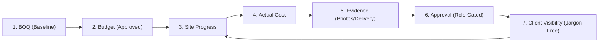
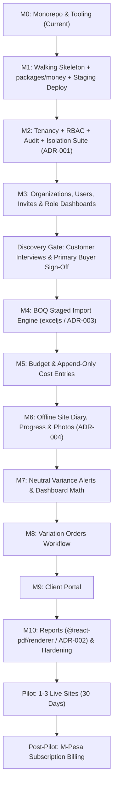

# System Architecture & Technical Design Document

**Project:** Kenya Construction SaaS (Multi-Tenant Platform)  
**Version:** 1.0.0  
**Status:** Approved Architecture Baseline  
**Date:** 2026-11-02  
**Author:** Engineering Lead (Gemini)  
**Auditor / Reviewer:** Independent Reviewer (Claude)  

---

## 1. System Vision & Core Product Loop

### 1.1 The Problem in the Kenyan Context
Kenyan building sites currently operate through fragmented, untracked channels:
- Bills of Quantities (BOQs) trapped in unstructured Excel spreadsheets.
- Material requisitions and delivery confirmations scattered across unstructured WhatsApp groups.
- Site progress tracked on handwritten physical paper site diaries susceptible to loss and dispute.
- Budget overruns and contractor claims discovered weeks or months after costs are already sunk.
- Project clients/developers who lack real-time visibility and must physically visit remote sites to verify progress.

### 1.2 The Core Product Loop
The system solves this with **one shared, multi-tenant digital project record** protecting the unbroken execution loop:



If a proposed feature does not strengthen this core loop, it is excluded from V1.

---

## 2. Monorepo Structure & Stack Selection

The platform is designed as a **Modular Monolith** in a Turborepo + pnpm monorepo, keeping operational complexity minimal for a solo engineer while enforcing strict domain boundaries.

```
construction-saas/
├── .github/
│   └── workflows/
│       └── ci.yml                 # Automated lint, typecheck, unit/integration CI
├── .env.example                   # Zero-secret environment template
├── package.json                   # Root workspace scripts (build, test, lint, typecheck)
├── pnpm-workspace.yaml            # Monorepo package directory configuration
├── turbo.json                     # Turborepo task pipeline
├── tsconfig.base.json             # Root strict TypeScript base configuration
├── docs/
│   ├── PRD.md                     # Product Requirements Document
│   ├── SYSTEM_DESIGN.md           # This document
│   ├── GEMINI.md                  # Project constitution & working agreement
│   ├── PROJECT_STATUS.md          # Live status & session log
│   ├── REMEDIATION_PLAN.md        # Risk, defect & remediation register
│   ├── research/                  # Phase 0 verified research outputs
│   └── adr/                       # Architecture Decision Records (ADR-001 to ADR-005)
├── apps/
│   ├── api/                       # Fastify 5 + TypeScript + Prisma 6 API
│   │   ├── src/
│   │   │   ├── index.ts           # Fastify server bootstrap & port binding
│   │   │   ├── config/            # Environment parsing & startup guards
│   │   │   ├── plugins/           # Prisma, JWT auth, Helmet, CORS, Error handling
│   │   │   ├── db/                # withTenantTx helper & Prisma client singleton
│   │   │   └── modules/           # Domain modules
│   │   │       ├── auth/          # Login, refresh tokens, invitations, passwords
│   │   │       ├── tenants/       # Company profiles & membership management
│   │   │       ├── projects/      # Project creation, assignment & dashboard
│   │   │       ├── boq/           # Excel parsing, validation & line item tree
│   │   │       ├── costs/         # Append-only cost logging & receipt attachment
│   │   │       ├── site/          # Site diary, labor headcount, weather, delivery
│   │   │       ├── progress/      # Physical progress measurement & verification
│   │   │       ├── variations/    # Change order submission, QS review, approval
│   │   │       ├── approvals/     # Role-based approval engine
│   │   │       ├── audit/         # Append-only audit trail logging
│   │   │       └── reports/       # PDF generation (@react-pdf/renderer)
│   │   └── tests/                 # Unit, integration & tenant-isolation test suites
│   └── web/                       # React 19 + Vite 6 + Tailwind 4 PWA
│       ├── src/
│       │   ├── main.tsx           # React bootstrap
│       │   ├── App.tsx            # Root route tree & global layout
│       │   ├── features/          # Feature slices matching API domains
│       │   ├── components/        # UI components (tables, cards, modals)
│       │   ├── lib/               # IndexedDB (Dexie), offline queue, sync worker
│       │   └── routes/            # Role-tailored views
│       └── tests/                 # Component & client flow tests
└── packages/
    ├── validation/                # Shared Zod schemas (API requests & client forms)
    ├── money/                     # Single source of financial math (decimal.js, ADR-005)
    ├── permissions/               # Permission catalogue & role->permission matrix
    └── ui/                        # Shared UI primitives
```

### Technology Matrix

| Layer | Choice | Rationale |
|---|---|---|
| **Monorepo** | Turborepo + pnpm | Fast incremental builds, local caching, workspace isolation. |
| **Backend API** | Fastify 5 + TypeScript (strict) | High-performance asynchronous HTTP engine with native schema validation and low container memory footprint. |
| **Database** | PostgreSQL 16 + Prisma 6 | Relational consistency, native Row-Level Security (RLS), and typed schema definitions. |
| **Frontend Web** | React 19 + Vite 6 + Tailwind 4 | Responsive Single-Page Application (SPA) configured as an installable PWA for mobile field users. |
| **Validation** | Zod (in `packages/validation`) | Single source of truth for runtime validation and TypeScript type inference shared across API and Web. |
| **Financial Engine** | `decimal.js` (in `packages/money`) | Arbitrary-precision decimal arithmetic; zero IEEE 754 floating-point errors. |
| **Local Storage (PWA)** | Dexie.js (IndexedDB) | Type-safe client-side database with transactional mutation queue. |
| **PDF Generation** | `@react-pdf/renderer` | Pure Node.js rendering (<50MB RAM footprint); avoids Puppeteer/Chromium OOM kills on Railway (ADR-002). |
| **Testing** | Vitest + Playwright | Ultra-fast unit/integration testing in Vitest; high-confidence E2E flows in Playwright. |
| **Deployment / CI** | Railway + GitHub Actions | Automated lint, typecheck, and test pipeline on every pull request; Railway staging environments. |

---

## 3. Complete Domain Data Model (Prisma Schema Specification)

Every tenant-owned table carries `tenant_id` as a foreign key and is protected by PostgreSQL `FORCE ROW LEVEL SECURITY`.

```prisma
datasource db {
  provider = "postgresql"
  url      = env("DATABASE_URL")
}

generator client {
  provider = "prisma-client-js"
}

// -------------------------------------------------------------
// TENANCY & IDENTITY
// -------------------------------------------------------------

model Tenant {
  id             String       @id @default(uuid()) @db.Uuid
  name           String       @db.VarChar(255)
  slug           String       @unique @db.VarChar(100)
  kra_pin        String?      @db.VarChar(20)
  nca_category   String?      @db.VarChar(50) // e.g. "NCA 4"
  currency       String       @default("KES") @db.VarChar(3)
  created_at     DateTime     @default(now()) @db.Timestamptz
  updated_at     DateTime     @updatedAt @db.Timestamptz

  memberships    Membership[]
  projects       Project[]
  idempotency    IdempotencyKey[]
  audit_logs     AuditLog[]

  @@map("tenants")
}

model User {
  id             String       @id @default(uuid()) @db.Uuid
  email          String       @unique @db.VarChar(255)
  password_hash  String       @db.VarChar(255)
  full_name      String       @db.VarChar(255)
  phone_number   String?      @db.VarChar(30)
  is_active      Boolean      @default(true)
  created_at     DateTime     @default(now()) @db.Timestamptz
  updated_at     DateTime     @updatedAt @db.Timestamptz

  memberships    Membership[]
  project_members ProjectMember[]
  cost_entries   CostEntry[]  @relation("CostCreator")
  cost_approvals CostApproval[]

  @@map("users")
}

model Membership {
  id         String     @id @default(uuid()) @db.Uuid
  tenant_id  String     @db.Uuid
  user_id    String     @db.Uuid
  role       String     @db.VarChar(50) // "ADMIN", "PM_QS", "SITE_SUPERVISOR", "CLIENT"
  created_at DateTime   @default(now()) @db.Timestamptz

  tenant     Tenant     @relation(fields: [tenant_id], references: [id], onDelete: Cascade)
  user       User       @relation(fields: [user_id], references: [id], onDelete: Cascade)

  @@unique([tenant_id, user_id])
  @@map("memberships")
}

// -------------------------------------------------------------
// PROJECTS
// -------------------------------------------------------------

model Project {
  id                   String          @id @default(uuid()) @db.Uuid
  tenant_id            String          @db.Uuid
  name                 String          @db.VarChar(255)
  code                 String          @db.VarChar(50)
  description          String?         @db.Text
  location             String?         @db.VarChar(255)
  nca_project_no       String?         @db.VarChar(100) // NCA Project Registration ID
  status               String          @default("ACTIVE") @db.VarChar(50) // "PLANNING", "ACTIVE", "COMPLETED", "ON_HOLD"
  original_contract_sum Decimal        @default(0.00) @db.Decimal(15, 2)
  current_approved_budget Decimal      @default(0.00) @db.Decimal(15, 2)
  start_date           DateTime?       @db.Date
  target_end_date      DateTime?       @db.Date
  created_at           DateTime        @default(now()) @db.Timestamptz
  updated_at           DateTime        @updatedAt @db.Timestamptz

  tenant               Tenant          @relation(fields: [tenant_id], references: [id], onDelete: Cascade)
  members              ProjectMember[]
  boqs                 BOQ[]
  cost_entries         CostEntry[]
  site_diaries         SiteDiary[]
  progress_records     ProgressRecord[]
  variation_orders     VariationOrder[]

  @@unique([tenant_id, code])
  @@index([tenant_id, status])
  @@map("projects")
}

model ProjectMember {
  id         String     @id @default(uuid()) @db.Uuid
  tenant_id  String     @db.Uuid
  project_id String     @db.Uuid
  user_id    String     @db.Uuid
  role       String     @db.VarChar(50) // Project-scoped role assignment
  created_at DateTime   @default(now()) @db.Timestamptz

  project    Project    @relation(fields: [project_id], references: [id], onDelete: Cascade)
  user       User       @relation(fields: [user_id], references: [id], onDelete: Cascade)

  @@unique([project_id, user_id])
  @@index([tenant_id, project_id])
  @@map("project_members")
}

// -------------------------------------------------------------
// BOQ & BUDGET BASELINE
// -------------------------------------------------------------

model BOQ {
  id             String       @id @default(uuid()) @db.Uuid
  tenant_id      String       @db.Uuid
  project_id     String       @db.Uuid
  version        Int          @default(1)
  status         String       @default("ACTIVE") @db.VarChar(50) // "ACTIVE", "SUPERSEDED"
  source_filename String?     @db.VarChar(255)
  total_amount   Decimal      @default(0.00) @db.Decimal(15, 2)
  created_at     DateTime     @default(now()) @db.Timestamptz

  project        Project      @relation(fields: [project_id], references: [id], onDelete: Cascade)
  sections       BOQSection[]

  @@unique([project_id, version])
  @@index([tenant_id, project_id])
  @@map("boqs")
}

model BOQSection {
  id         String     @id @default(uuid()) @db.Uuid
  tenant_id  String     @db.Uuid
  boq_id     String     @db.Uuid
  order_idx  Int
  title      String     @db.VarChar(255) // e.g. "Section 2: Substructure"
  total_amount Decimal  @default(0.00) @db.Decimal(15, 2)

  boq        BOQ        @relation(fields: [boq_id], references: [id], onDelete: Cascade)
  items      BOQItem[]

  @@index([tenant_id, boq_id])
  @@map("boq_sections")
}

model BOQItem {
  id             String           @id @default(uuid()) @db.Uuid
  tenant_id      String           @db.Uuid
  section_id     String           @db.Uuid
  item_code      String           @db.VarChar(50) // e.g. "A", "2.1.1"
  description    String           @db.Text
  unit           String           @db.VarChar(20) // "SM", "CM", "LM", "KG", "NO", "ITEM"
  quantity       Decimal          @db.Decimal(12, 4) // Measured net quantity
  unit_rate      Decimal          @db.Decimal(15, 4) // Rate in KES
  total_amount   Decimal          @db.Decimal(15, 2) // qty * rate
  is_provisional Boolean          @default(false)
  created_at     DateTime         @default(now()) @db.Timestamptz

  section        BOQSection       @relation(fields: [section_id], references: [id], onDelete: Cascade)
  cost_entries   CostEntry[]
  progress_items ProgressItem[]
  variation_items VariationItem[]

  @@index([tenant_id, section_id])
  @@map("boq_items")
}

// -------------------------------------------------------------
// SITE DIARY & FIELD EVIDENCE (OFFLINE-CAPABLE DOMAIN)
// -------------------------------------------------------------

model SiteDiary {
  id               String               @id @default(uuid()) @db.Uuid
  tenant_id        String               @db.Uuid
  project_id       String               @db.Uuid
  entry_date       DateTime             @db.Date
  weather          String               @db.VarChar(50) // "SUNNY", "RAIN_DELAY", "HEAVY_RAIN"
  site_status      String               @db.VarChar(50) // "OPERATIONAL", "STOPPED", "PARTIAL"
  general_notes    String?              @db.Text
  recorded_by_id   String               @db.Uuid
  created_at       DateTime             @default(now()) @db.Timestamptz

  project          Project              @relation(fields: [project_id], references: [id], onDelete: Cascade)
  photos           SitePhoto[]
  labor_headcounts LaborHeadcount[]
  deliveries       MaterialDelivery[]

  @@unique([project_id, entry_date])
  @@index([tenant_id, project_id])
  @@map("site_diaries")
}

model SitePhoto {
  id             String     @id @default(uuid()) @db.Uuid
  tenant_id      String     @db.Uuid
  site_diary_id  String     @db.Uuid
  storage_key    String     @db.VarChar(500) // S3 object key
  caption        String?    @db.VarChar(255)
  taken_at       DateTime   @db.Timestamptz
  gps_latitude   Decimal?   @db.Decimal(9, 6)
  gps_longitude  Decimal?   @db.Decimal(9, 6)
  created_at     DateTime   @default(now()) @db.Timestamptz

  site_diary     SiteDiary  @relation(fields: [site_diary_id], references: [id], onDelete: Cascade)

  @@index([tenant_id, site_diary_id])
  @@map("site_photos")
}

model LaborHeadcount {
  id            String     @id @default(uuid()) @db.Uuid
  tenant_id     String     @db.Uuid
  site_diary_id String     @db.Uuid
  trade_type    String     @db.VarChar(100) // "Mason", "Steel Fixer", "Carpenter", "Casual"
  headcount     Int        @default(1)

  site_diary    SiteDiary  @relation(fields: [site_diary_id], references: [id], onDelete: Cascade)

  @@index([tenant_id, site_diary_id])
  @@map("labor_headcounts")
}

model MaterialDelivery {
  id            String     @id @default(uuid()) @db.Uuid
  tenant_id     String     @db.Uuid
  site_diary_id String     @db.Uuid
  material_name String     @db.VarChar(255) // e.g. "Machine-Cut Stone 9x9"
  quantity      Decimal    @db.Decimal(12, 4)
  unit          String     @db.VarChar(20)
  supplier_name String?    @db.VarChar(255)
  delivery_note String?    @db.VarChar(100)

  site_diary    SiteDiary  @relation(fields: [site_diary_id], references: [id], onDelete: Cascade)

  @@index([tenant_id, site_diary_id])
  @@map("material_deliveries")
}

// -------------------------------------------------------------
// PHYSICAL PROGRESS RECORDING
// -------------------------------------------------------------

model ProgressRecord {
  id             String         @id @default(uuid()) @db.Uuid
  tenant_id      String         @db.Uuid
  project_id     String         @db.Uuid
  record_date    DateTime       @db.Date
  overall_progress Decimal      @db.Decimal(5, 4) // e.g. 0.4500 (45.00%)
  notes          String?        @db.Text
  created_at     DateTime       @default(now()) @db.Timestamptz

  project        Project        @relation(fields: [project_id], references: [id], onDelete: Cascade)
  items          ProgressItem[]

  @@index([tenant_id, project_id, record_date])
  @@map("progress_records")
}

model ProgressItem {
  id                 String         @id @default(uuid()) @db.Uuid
  tenant_id          String         @db.Uuid
  progress_record_id String         @db.Uuid
  boq_item_id        String         @db.Uuid
  completed_quantity Decimal        @db.Decimal(12, 4) // Cumulative measured quantity to date
  completion_pct     Decimal        @db.Decimal(5, 4) // e.g. 0.6000 (60.00%)

  progress_record    ProgressRecord @relation(fields: [progress_record_id], references: [id], onDelete: Cascade)
  boq_item           BOQItem        @relation(fields: [boq_item_id], references: [id], onDelete: Cascade)

  @@index([tenant_id, progress_record_id])
  @@map("progress_items")
}

// -------------------------------------------------------------
// ACTUAL COSTS & APPROVALS (APPEND-ONLY FINANCIAL LEDGER)
// -------------------------------------------------------------

model CostEntry {
  id             String         @id @default(uuid()) @db.Uuid
  tenant_id      String         @db.Uuid
  project_id     String         @db.Uuid
  boq_item_id    String?        @db.Uuid
  cost_category  String         @db.VarChar(50) // "MATERIAL", "LABOR", "PLANT", "SUBCONTRACT", "PRELIMINARY"
  amount         Decimal        @db.Decimal(15, 2)
  vendor_name    String?        @db.VarChar(255)
  invoice_ref    String?        @db.VarChar(100)
  description    String         @db.Text
  status         String         @default("PENDING") @db.VarChar(50) // "PENDING", "APPROVED", "REJECTED", "VOIDED"
  created_by_id  String         @db.Uuid
  created_at     DateTime       @default(now()) @db.Timestamptz

  project        Project        @relation(fields: [project_id], references: [id], onDelete: Cascade)
  boq_item       BOQItem?       @relation(fields: [boq_item_id], references: [id])
  created_by     User           @relation("CostCreator", fields: [created_by_id], references: [id])
  receipts       CostReceipt[]
  approvals      CostApproval[]

  @@index([tenant_id, project_id, status])
  @@map("cost_entries")
}

model CostReceipt {
  id            String     @id @default(uuid()) @db.Uuid
  tenant_id     String     @db.Uuid
  cost_entry_id String     @db.Uuid
  storage_key   String     @db.VarChar(500)
  filename      String     @db.VarChar(255)
  file_size     Int
  mime_type     String     @db.VarChar(100)
  created_at    DateTime   @default(now()) @db.Timestamptz

  cost_entry    CostEntry  @relation(fields: [cost_entry_id], references: [id], onDelete: Cascade)

  @@index([tenant_id, cost_entry_id])
  @@map("cost_receipts")
}

model CostApproval {
  id            String     @id @default(uuid()) @db.Uuid
  tenant_id     String     @db.Uuid
  cost_entry_id String     @db.Uuid
  reviewer_id   String     @db.Uuid
  action        String     @db.VarChar(50) // "APPROVED", "REJECTED"
  comments      String?    @db.Text
  created_at    DateTime   @default(now()) @db.Timestamptz

  cost_entry    CostEntry  @relation(fields: [cost_entry_id], references: [id], onDelete: Cascade)
  reviewer      User       @relation(fields: [reviewer_id], references: [id])

  @@index([tenant_id, cost_entry_id])
  @@map("cost_approvals")
}

// -------------------------------------------------------------
// VARIATION ORDERS
// -------------------------------------------------------------

model VariationOrder {
  id                   String          @id @default(uuid()) @db.Uuid
  tenant_id            String          @db.Uuid
  project_id           String          @db.Uuid
  variation_no         Int
  title                String          @db.VarChar(255)
  reason               String          @db.Text
  status               String          @default("SUBMITTED") @db.VarChar(50) // "SUBMITTED", "QS_EVALUATED", "APPROVED", "REJECTED"
  net_amount           Decimal         @db.Decimal(15, 2) // Positive or negative
  time_extension_days  Int             @default(0)
  approved_at          DateTime?       @db.Timestamptz
  created_at           DateTime        @default(now()) @db.Timestamptz

  project              Project         @relation(fields: [project_id], references: [id], onDelete: Cascade)
  items                VariationItem[]

  @@unique([project_id, variation_no])
  @@index([tenant_id, project_id, status])
  @@map("variation_orders")
}

model VariationItem {
  id                 String          @id @default(uuid()) @db.Uuid
  tenant_id          String          @db.Uuid
  variation_order_id String          @db.Uuid
  boq_item_id        String?         @db.Uuid
  description        String          @db.Text
  unit               String          @db.VarChar(20)
  quantity           Decimal         @db.Decimal(12, 4) // Positive (addition) or negative (omission)
  unit_rate          Decimal         @db.Decimal(15, 4)
  total_amount       Decimal         @db.Decimal(15, 2)

  variation_order    VariationOrder  @relation(fields: [variation_order_id], references: [id], onDelete: Cascade)
  boq_item           BOQItem?        @relation(fields: [boq_item_id], references: [id])

  @@index([tenant_id, variation_order_id])
  @@map("variation_items")
}

// -------------------------------------------------------------
// AUDIT LOG & IDEMPOTENCY
// -------------------------------------------------------------

model AuditLog {
  id         String     @id @default(uuid()) @db.Uuid
  tenant_id  String     @db.Uuid
  project_id String?    @db.Uuid
  actor_id   String     @db.Uuid
  action     String     @db.VarChar(100) // e.g. "COST_ENTRY_APPROVED", "BOQ_IMPORTED"
  entity_type String    @db.VarChar(100)
  entity_id  String     @db.Uuid
  changes    Json?      // Structured before/after diff
  ip_address String?    @db.VarChar(50)
  user_agent String?    @db.VarChar(255)
  created_at DateTime   @default(now()) @db.Timestamptz

  tenant     Tenant     @relation(fields: [tenant_id], references: [id], onDelete: Cascade)

  @@index([tenant_id, entity_type, entity_id])
  @@index([tenant_id, project_id, created_at])
  @@map("audit_logs")
}

model IdempotencyKey {
  id              String     @id @default(uuid()) @db.Uuid
  tenant_id       String     @db.Uuid
  idempotency_key String     @db.VarChar(255)
  response_status Int
  response_body   Json
  created_at      DateTime   @default(now()) @db.Timestamptz

  tenant          Tenant     @relation(fields: [tenant_id], references: [id], onDelete: Cascade)

  @@unique([tenant_id, idempotency_key])
  @@map("idempotency_keys")
}
```

---

## 4. Multi-Tenancy & Transactional Isolation Architecture (ADR-001)

### 4.1 Defense-in-Depth Model
Data isolation operates through two independent, mandatory layers:
1. **Layer 1 (Application Layer):** Every repository query requires a `TenantContext` containing `tenantId`. Direct unbound queries (`where: {}`) are prohibited by static analysis.
2. **Layer 2 (PostgreSQL Engine Layer):** Row-Level Security with `FORCE ROW LEVEL SECURITY` enforced across all tenant tables.

### 4.2 The Explicit `withTenantTx` Pattern
To eliminate the transaction rollback defects of Prisma Client Extensions (Issue #55), all financial mutations and audit records execute via the explicit helper:

```typescript
export function withTenantTx<T>(
  prisma: PrismaClient,            // Base client connected as db_app
  tenantId: string,
  fn: (tx: Prisma.TransactionClient) => Promise<T>,
): Promise<T> {
  return prisma.$transaction(async (tx) => {
    // 1. Scope tenant context strictly to this leased transaction
    await tx.$executeRaw`SELECT set_config('app.current_tenant_id', ${tenantId}, TRUE)`;
    
    // 2. Execute business operations using tx
    return fn(tx);
  });
}
```

### 4.3 Automated CI Security Checks
- **Catalog Verification:** A test runs against PostgreSQL `pg_class` verifying that for every table with a `tenant_id` column, `relrowsecurity = true` and `relforcerowsecurity = true`.
- **Runtime Role Verification:** A test verifies that the runtime user has `rolsuper = false` and `rolbypassrls = false`.
- **API Startup Guard:** The Fastify server checks `SELECT current_user` on initialization and throws a fatal exit error if connected as table owner or superuser.
- **Rollback Test:** A forced exception during a multi-step write asserts that change + audit + idempotency key all roll back cleanly.

---

## 5. Permission-Based RBAC Architecture

The platform checked permissions rather than role strings (`user.can('cost.approve')`, never `user.role === 'PM'`). This allows adding future roles (Finance, Procurement, Subcontractors) as simple configuration without code rewrites.

### 5.1 V1 Role Catalogue

| Role (V1) | Purpose / Mental Model | Project Scope | Primary Dashboards & Capabilities |
|---|---|---|---|
| **Company Admin / Contractor** | Portfolio health, company cash flow, executive risk. | All company projects | Portfolio value, total approved budget vs actual cost, pending high-value approvals, company user invites. |
| **PM / QS** | Commercial control, BOQ budget management, contract variations. | Assigned projects | BOQ import, line item tracking, cost approvals, variation review, progress alignment. |
| **Site Supervisor / Foreman** | Daily task execution, material verification, site safety. | Assigned project(s) | Daily site diary, labor headcount, material delivery receipts, photo uploads, offline capture. |
| **Client / Developer** | Jargon-free financial visibility, project milestones. | Assigned project (Read-Only + Approvals) | Completion %, 5 financial cards, timestamped photo feed, variation approval actions. |

### 5.2 Permission Matrix

| Permission | Admin | PM / QS | Site Supervisor | Client |
|---|:---:|:---:|:---:|:---:|
| `project.create` | ✅ | ❌ | ❌ | ❌ |
| `project.view` | ✅ | ✅ | ✅ | ✅ (assigned) |
| `boq.import` | ✅ | ✅ | ❌ | ❌ |
| `boq.view` | ✅ | ✅ | ❌ | ✅ (summary) |
| `cost.create` | ✅ | ✅ | ✅ | ❌ |
| `cost.approve` | ✅ | ✅ | ❌ | ❌ |
| `site.diary_create` | ✅ | ✅ | ✅ | ❌ |
| `progress.record` | ✅ | ✅ | ✅ | ❌ |
| `variation.request` | ✅ | ✅ | ❌ | ❌ |
| `variation.approve`| ✅ | ❌ | ❌ | ✅ |
| `report.generate` | ✅ | ✅ | ❌ | ✅ |
| `company.invite` | ✅ | ❌ | ❌ | ❌ |

---

## 6. Financial Engine & Precision Architecture (ADR-005)

### 6.1 Database Precision Specifications
- **Currency Amounts:** PostgreSQL `numeric(15,2)`, 2 decimal places.
- **Unit Rates:** PostgreSQL `numeric(15,4)`, up to 4 decimal places.
- **Measured Quantities:** PostgreSQL `numeric(12,4)`, up to 4 decimal places.

### 6.2 Application-Layer Rules (`packages/money`)
- All arithmetic executes server-side via `decimal.js`. Native JavaScript `number` arithmetic on money is forbidden.
- In intermediate calculations, full precision is maintained.
- `ROUND_HALF_UP` is applied **only once at the document/certificate total level**.

### 6.3 Financial Invariants
1. **Current Approved Budget:**
   $$\text{Current Approved Budget} = \text{Original BOQ Budget} + \sum \text{Approved Variations}$$
2. **Cost Consumption %:**
   $$\text{Cost Consumption \%} = \frac{\text{Actual Approved Cost}}{\text{Current Approved Budget}}$$
3. **Neutral Variance Flag:**
   - If $\text{Cost Consumption \%} - \text{Physical Progress \%} \ge 15\%$, the UI displays:
     > *"Cost consumption is significantly ahead of recorded physical progress. Review project costs and progress records."*
   - Strictly neutral, non-inflammatory language (never using "theft", "fraud", or "stolen").

---

## 7. Offline PWA Synchronization Architecture (ADR-004)

### 7.1 Scope & Boundaries
- **Offline Allowed:** Daily site diary, daily labor headcounts, physical progress % updates, and site photos.
- **Strictly Online-Only:** Financial approvals, BOQ imports, variation orders, and permission modifications.

### 7.2 Image Compression & Mutation Pipeline
- Client compresses photos via Canvas API to max 1280px width, JPEG 0.7 before storing in IndexedDB (~150KB per photo, down from ~8MB).
- Mutations stored in Dexie.js with a client-generated UUIDv4 idempotency key.
- On network recovery, queued mutations flush chronologically with `Idempotency-Key: <key>`.
- Fastify server enforces unique constraint on `(tenant_id, idempotency_key)` to guarantee exactly-once processing.

---

## 8. Staged Excel BOQ Ingestion Pipeline (ADR-003)

To safely parse real-world Kenyan BOQs compiled under the East African Standard Method of Measurement (EASMM), the import follows a 6-stage lifecycle using `exceljs`:
1. **Upload & Parse:** Reads workbook, resolves merged cell coordinate boundaries, and extracts row arrays.
2. **Column Mapping:** Auto-detects standard columns (`Item`, `Description`, `Unit`, `Quantity`, `Rate`, `Amount`) with a user-confirmation interface.
3. **Server Validation:** Verifies non-negative values, checks arithmetic ($|\text{qty} \times \text{rate} - \text{amount}| \le 0.05$), and detects provisional sums.
4. **Interactive Preview:** Shows green (valid), amber (warning), and red (rejected) rows with specific line error messages and grand total comparison.
5. **Explicit Confirmation:** User confirms row counts and excludes invalid rows.
6. **Atomic Commit:** All sections and items committed within a single `withTenantTx` transaction with an audit log record.

---

## 9. Statutory Compliance & Legal Alignment

1. **BORAQS & Cap. 525:** The platform is positioned strictly as a management and calculation software tool for project teams. Marketing and UI copy must never claim the software is an "Automated QS" or replaces registered professionals.
2. **Data Protection Act 2019:**
   - Universal compliance with data security principles and mandatory 72-hour breach notification to the ODPC (Section 43).
   - Startup exemption from mandatory *registration* applies only while turnover < KES 5M **AND** < 10 employees, provided the platform avoids Third Schedule exclusions (e.g. property management or CCTV surveillance).
   - Statutory tax record retention of at least 5 years (Tax Procedures Act 2015, Section 23).
3. **KRA eTIMS:** The platform must be integrated with eTIMS to issue electronic tax invoices for SaaS subscriptions before commercial billing.

---

## 10. Milestone Execution & Verification Roadmap


