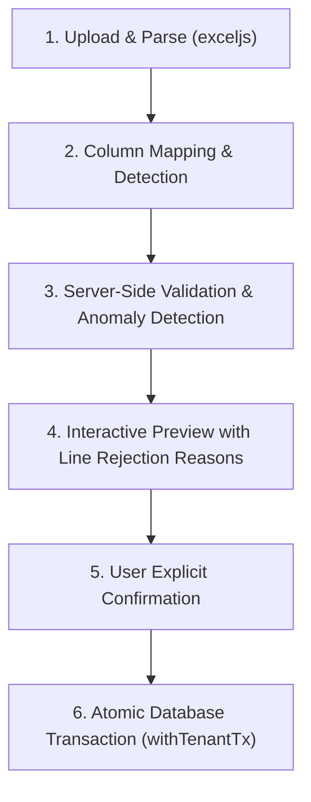

# ADR-003: Staged Excel BOQ Import Pipeline

- **Status:** Draft (Awaiting field sample validation in Milestone M4)
- **Date:** 2026-11-02
- **Deciders:** Engineering Lead (Gemini), Project Owner, Independent Reviewer (Claude)
- **Relevant Issues:** Remediation Plan R-012, Milestone M4 Scope

---

## 1. Context & Problem Statement

The Bill of Quantities (BOQ) is the foundational financial baseline of a construction project. In Kenya, BOQs are prepared by Quantity Surveyors in Microsoft Excel under the East African Standard Method of Measurement (EASMM).

Real-world Excel BOQs exhibit severe structural irregularities:
1. **Merged Cells:** Section headings, item codes, and multi-line descriptions frequently span merged columns/rows. Standard spreadsheet parsers assign the value solely to the top-left cell, leaving all other cells `null` or empty.
2. **Subtotal & Collection Rows:** Rows containing "Total Carried to Collection", "Subtotal", or page summaries contain currency totals without quantities or unit rates.
3. **Prime Cost (PC) & Provisional Sums:** Items formatted with description text and an amount in the total column without unit rates or quantities.
4. **Messy Formatting:** Numbers formatted as `"KSh 1,500,000/="`, `" 1,500,000.00 "`, or enclosed in parentheses for negative adjustments.
5. **Formula Inconsistencies:** Spreadsheets often contain broken formulas (`#REF!`, `#DIV/0!`) or manual value overrides.

A naive single-click import risks silently dropping line items, calculating incorrect project budgets, or misallocating millions of shillings.

---

## 2. Decision

We mandate a **6-stage validated import lifecycle** implemented with **`exceljs`** (chosen for its full support of merged cell coordinate ranges, MIT open-source license, and streaming parsing capability).

### The 6-Stage Import Pipeline



#### Stage 1: Upload & Cell Coordinate Normalization
- File size capped at 15MB.
- `exceljs` parses the workbook. For every merged cell range, the parser normalizes coordinates and propagates section hierarchy down to child rows.

#### Stage 2: Column Mapping
- The parser auto-detects standard Kenyan BOQ headers:
  - `Item No` / `Ref` / `Clause`
  - `Description` / `Specification`
  - `Unit` (`SM`, `CM`, `LM`, `KG`, `NO`, `ITEM`)
  - `Quantity` / `Qty`
  - `Rate` / `Unit Rate`
  - `Amount` / `Total`
- If auto-detection confidence is below 100%, the user is presented with a column mapping interface to confirm column assignments before proceeding.

#### Stage 3: Server-Side Row Validation
Every extracted row is evaluated by server-side Zod validation rules:
- **Quantity:** Must be non-negative `numeric(12,4)`.
- **Unit Rate:** Must be non-negative `numeric(15,4)`.
- **Arithmetic Check:** The parsed row is verified against `abs((qty * rate) - amount) <= 0.05`. If discrepancy exceeds 5 cents, the row is flagged as an anomaly.
- **Section Headers & Subtotals:** Detected and classified as structural metadata rather than billable items.
- **Provisional / PC Sums:** Classified with `is_provisional = true` when amount is present without unit rate or quantity.

#### Stage 4: Interactive Preview Table
- The UI renders the parsed BOQ with color-coded status badges:
  - **Green (Valid):** Ready for import.
  - **Amber (Warning):** Arithmetic discrepancy or provisional sum flagged for review.
  - **Red (Rejected):** Invalid data type, unparseable rate, or missing required description. Explicit error message provided per row.
- Subtotals and Grand Total are dynamically calculated and shown next to the original Excel spreadsheet grand total for human comparison.

#### Stage 5: User Explicit Confirmation
- The user must explicitly click "Confirm and Import X Items". If any red rows exist, the user must choose between "Exclude Invalid Rows" or "Cancel and Re-upload".

#### Stage 6: Atomic Database Transaction
- All valid sections and items are committed in **one** `withTenantTx` transaction:
  ```typescript
  await withTenantTx(prisma, tenantId, async (tx) => {
    const boq = await boqRepo.create(tx, { projectId, version: 1, status: 'ACTIVE' });
    await boqRepo.insertSectionsAndItems(tx, boq.id, validatedData);
    await auditRepo.log(tx, { action: 'BOQ_IMPORTED', entityId: boq.id, metadata: { totalItems, grandTotal } });
  });
  ```

---

## 3. Consequences

### Positive
- Financial corruption of project budgets is prevented before data ever touches the database.
- Merged-cell and formatting quirks common to Kenyan consulting practices are safely resolved.
- Full auditability: Every imported line item has an associated upload record and confirmation trail.

### Negative / Trade-offs
- Two-step asynchronous user experience (upload -> preview -> confirm) rather than instant upload.
- Requires client-side preview rendering for large spreadsheets (1,000+ line items), requiring table virtualization.
