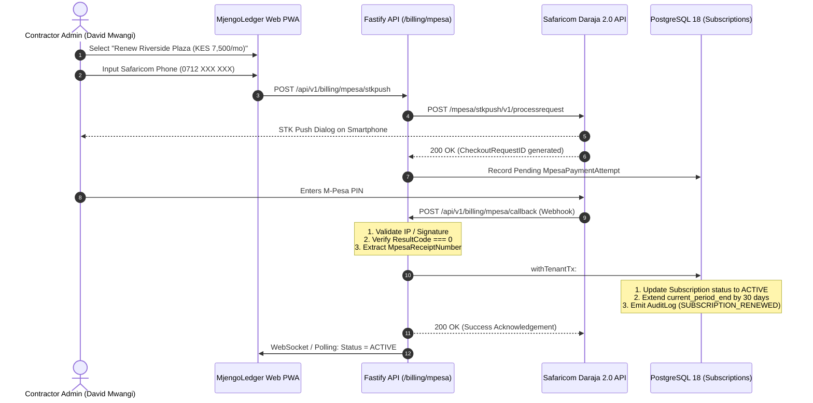

# ADR-006: Safaricom Daraja 2.0 M-Pesa Subscription Billing Architecture

- **Status:** Proposed (Scheduled for Post-Pilot Commercialization Phase)
- **Date:** 2026-11-03
- **Deciders:** Engineering Lead (Gemini), Project Owner, Independent Reviewer (Claude)
- **Relevant Issues:** Milestone PILOT Scope, PRD Section 6, Discovery Gate Synthesis

---

## 1. Context & Business Need

During the Discovery Gate synthesis across 9 Kenyan contractors and property developers, the payment model was validated:
- **Primary Buyer:** Main Contractor (NCA Categories 3–6 Building Contractors).
- **Pricing Hypothesis:** KES 7,500 / active project / month, or KES 25,000 / month for full portfolio access.
- **Payment Method Preference:** In Kenya, credit cards have low penetration among SME contractors (< 15%). M-Pesa is universal, instant, and the default commercial settlement rail for SME businesses.

To monetize MjengoLedger sustainably after the 30-day live site pilot, the platform requires an automated subscription billing engine powered by **Safaricom Daraja 2.0 STK Push (Lipa na M-Pesa Online)**.

---

## 2. Decision & Architectural Principles

### 2.1 Subscription-Only Scope (Zero Project Payouts)
MjengoLedger acts exclusively as a software provider collecting its own subscription SaaS fees. **The platform does NOT handle or escrow construction project payouts or contractor payments in V1.** Project interim certificate payments remain settled through standard commercial bank RTGS/EFT directly between client and contractor.

### 2.2 Billing Mechanics: Daraja 2.0 STK Push
Subscriptions are initiated via Daraja's `Customer-to-Business` STK Push:
1. When a contractor activates or renews a project, the Fastify API calls Daraja STK Push endpoint:
   `POST https://api.safaricom.co.ke/mpesa/stkpush/v1/processrequest`
2. The contractor owner receives an instant SIM toolkit prompt on their phone:  
   *"Do you want to pay KES 7,500.00 to MjengoLedger for Project Riverside Plaza? Enter M-Pesa PIN:"*
3. Upon PIN entry, Safaricom delivers an asynchronous JSON callback payload to MjengoLedger's webhook.



---

## 3. Data Model Specification

To be migrated into Prisma schema upon entering post-pilot commercial phase:

```prisma
enum SubscriptionStatus {
  TRIALING
  ACTIVE
  PAST_DUE
  GRACE_PERIOD
  SUSPENDED
  CANCELLED
}

model Subscription {
  id                    String             @id @default(uuid()) @db.Uuid
  tenant_id             String             @db.Uuid
  project_id            String?            @db.Uuid
  plan_tier             String             @db.VarChar(50) // "PER_PROJECT" (7500), "PORTFOLIO" (25000)
  amount                Decimal            @db.Decimal(15, 2)
  currency              String             @default("KES") @db.VarChar(3)
  status                SubscriptionStatus @default(TRIALING)
  current_period_start  DateTime           @db.Timestamptz
  current_period_end    DateTime           @db.Timestamptz
  grace_period_end      DateTime?          @db.Timestamptz
  created_at            DateTime           @default(now()) @db.Timestamptz
  updated_at            DateTime           @updatedAt @db.Timestamptz

  tenant                Tenant             @relation(fields: [tenant_id], references: [id], onDelete: Cascade)
  payments              MpesaPayment[]

  @@index([tenant_id, status])
}

model MpesaPayment {
  id                   String        @id @default(uuid()) @db.Uuid
  tenant_id            String        @db.Uuid
  subscription_id      String        @db.Uuid
  merchant_request_id  String        @db.VarChar(100)
  checkout_request_id  String        @unique @db.VarChar(100)
  mpesa_receipt_number String?       @unique @db.VarChar(50)
  phone_number         String        @db.VarChar(20)
  amount               Decimal       @db.Decimal(15, 2)
  result_code          Int
  result_desc          String        @db.VarChar(255)
  paid_at              DateTime?     @db.Timestamptz
  created_at           DateTime      @default(now()) @db.Timestamptz

  subscription         Subscription  @relation(fields: [subscription_id], references: [id], onDelete: Cascade)

  @@index([tenant_id, checkout_request_id])
}
```

---

## 4. Security & Replay Attack Defense

1. **Idempotency on Callback:**
   - Safaricom occasionally retries webhook delivery.
   - The database enforces a `UNIQUE` constraint on `mpesa_receipt_number`.
   - If an existing receipt is received, the handler acknowledges with HTTP 200 and ignores duplicate processing.
2. **IP Whitelisting & Origin Guard:**
   - Production Fastify gateway checks incoming webhook client IP against Safaricom's published gateway ranges:
     - `196.201.214.0/24`
     - `196.201.213.0/24`
   - Rejects unauthorized external requests with HTTP 403 Forbidden.
3. **Grace Period Protocol:**
   - If a contractor's payment fails or lapses, the system enters `GRACE_PERIOD` for **7 days**.
   - During grace period: Site Supervisors and PMs retain full read/write access to avoid disrupting live construction operations. A neutral advisory banner informs the Admin: *"Your subscription renewal is pending. Please complete payment to avoid service interruption."*
   - After grace period: Account switches to `SUSPENDED` (strictly read-only mode). Field data is preserved forever; zero data is ever deleted.

---

## 5. Verification & Rollout Plan

- **Phase 1 (During Pilot):** Contractors operate on 30-day full feature access with `status: TRIALING`.
- **Phase 2 (End of Pilot):** Enable Daraja sandbox verification with Safaricom Daraja test credentials and M-Pesa simulator phone numbers.
- **Phase 3 (Production Billing):** Switch to live Daraja Business Shortcode (Paybill / Buy Goods) and commence commercial subscription billing.
