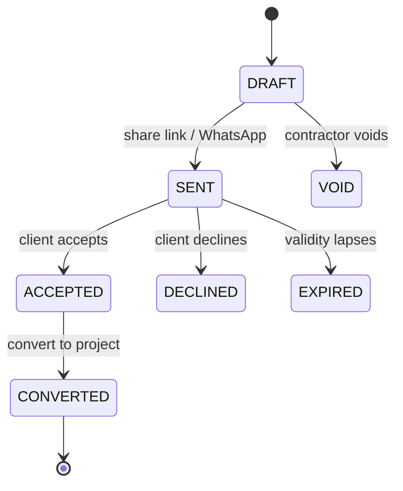
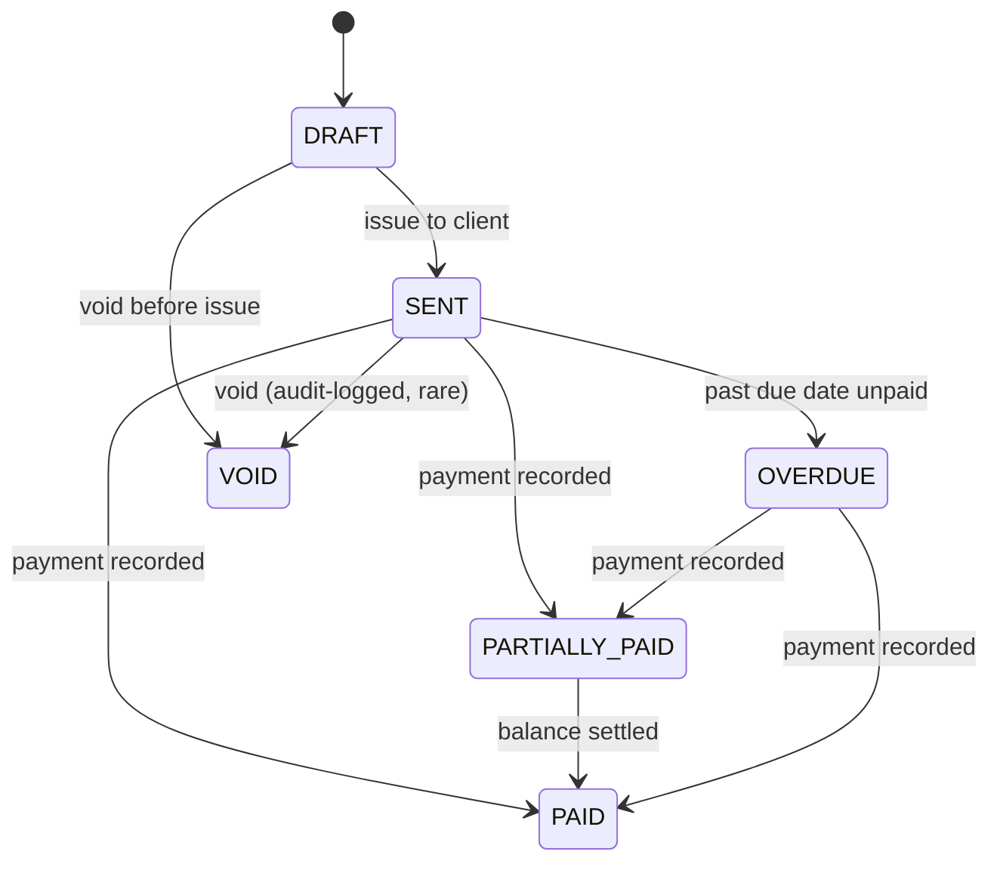

# ADR-007: Quotes-to-cash chain (Quote → Project → Invoice)

**Status:** proposed · **Date:** 2026-11-06 · **Deciders:** owner + CTO · **Evidence:** `docs/research/console-audit/03_workflows/`, `04_journeys.md` J1 [OBSERVED]

## Context

Observed competitor flow [OBSERVED]: the contractor money journey starts at a **quote** — template line items → WhatsApp share link → client accepts on phone → convert to project → deposit invoice auto-drafted → sent → paid. Our schema has no Quote or client-accounts-receivable Invoice entities. `ETimsInvoice` covers statutory tax invoices, not AR; `CostEntry` records internal spend, not billable work.

Without this chain, a Kenyan contractor must run quotes/invoices in WhatsApp + Excel and re-key into the platform — the exact fragmentation the product exists to remove.

## Options

- **A. New `Quote`/`QuoteLine`/`Invoice`/`InvoiceLine` models** mirroring the observed field set (client name/phone/email, site + GPS, line items w/ units, discount, VAT %, deposit %, terms, status `draft/sent/accepted/declined/expired`; invoice #, bill/ship-to, payment terms Net 7–60, PO number, qty/rate/amount, tax/discount, amount paid, balance).
- **B. Extend `CostEntry`** — rejected: cost entries are internal spend with approval workflow; they have no client-facing statuses, payment terms, or public share links. Overloading them breaks the cost ledger's immutability assumptions.
- **C. External tool (Wave/QuickBooks)** — rejected: breaks the evidence chain (quote→project→certificate→payment) that is the product's core value; adds reconciliation burden for a solo founder.
- **D. Defer entirely** — rejected for V1 money chain but acceptable as first sub-slice if Gate 4 sequencing demands; the chain is MUST per `MVP_SCOPE.md`.

## Decision

Option A. New tenant-scoped tables: `quotes`, `quote_lines`, `invoices`, `invoice_lines` (+ status enums per codebase convention).

- Quote→project conversion creates `Project` + optional deposit `Invoice` (status `sent`).
- All money via `packages/money` Decimal — never float.
- All tables: `tenant_id` + PostgreSQL RLS `FORCE ROW LEVEL SECURITY`, non-superuser `db_app` runtime, isolation tests.
- All mutations audit-logged via existing `AuditLog`.
- WhatsApp share = tokenized public link reusing the `PortalAccessLink` token pattern (hashed token, expiry, revocation).

## State diagrams





## Data model & migration plan

```prisma
model Quote {
  id            String      @id @default(cuid())
  tenantId      String
  projectId     String?     // set on conversion
  quoteNumber   String      // per-tenant sequence, e.g. QT-2026-0001
  clientName    String
  clientPhone   String?
  clientEmail   String?
  siteAddress   String?
  siteLat       Decimal?
  siteLng       Decimal?
  discountPct   Decimal     @default(0)
  vatPct        Decimal     @default(16) // Kenya standard VAT — confirm rate at implementation
  depositPct    Decimal     @default(0)
  terms         String?
  validityDays  Int         @default(30)
  status        QuoteStatus @default(DRAFT)
  shareToken    String?     @unique // hashed
  shareExpiresAt DateTime?
  convertedProjectId String?
  createdById   String
  createdAt     DateTime    @default(now())
  updatedAt     DateTime    @updatedAt
  lines         QuoteLine[]
  @@unique([tenantId, quoteNumber])
}

model QuoteLine {
  id        String  @id @default(cuid())
  quoteId   String
  description String
  unit      String?
  quantity  Decimal
  rate      Decimal // minor-unit-safe via packages/money at API layer
  amount    Decimal // computed server-side, stored for audit
  sortOrder Int     @default(0)
}

model Invoice {
  id            String        @id @default(cuid())
  tenantId      String
  projectId     String
  quoteId       String?
  invoiceNumber String        // per-tenant sequence INV-YYYY-NNNN
  billToName    String
  billToPin     String?       // KRA PIN for eTIMS later
  poNumber      String?
  paymentTermsDays Int        @default(30) // Net 7–60 validated
  issueDate     DateTime      @default(now())
  dueDate       DateTime
  subtotal      Decimal
  taxAmount     Decimal
  discountAmount Decimal
  totalAmount   Decimal
  amountPaid    Decimal       @default(0)
  balanceDue    Decimal       // generated/stored, recomputed on payment
  currency      String        @default("KES")
  status        InvoiceStatus @default(DRAFT)
  etimsStatus   String        @default("NOT_SUBMITTED") // stub until VSCU integration
  payments      InvoicePayment[]
  lines         InvoiceLine[]
  @@unique([tenantId, invoiceNumber])
}
```

**Migration:** `prisma migrate dev` new tables only — no changes to existing tables except optional `Project.sourceQuoteId` back-reference. Numbering sequences per tenant via existing sequence/counter pattern (check `VariationOrder` numbering implementation and reuse). RLS policies added in same migration script alongside `rls.sql` updates. No data backfill needed (greenfield entities).

## Test plan

- Unit (`packages/money`): VAT/discount/deposit math, balance-due recomputation — Given/When/Then.
- API integration: quote CRUD, share-link token issue/revoke/expiry, accept/decline transitions, convert-to-project idempotency (double-submit safe), invoice issue/void, payment recording → balance recompute, overdue detection job.
- Tenant isolation: `db_app` cross-tenant read/write denied for all four tables (extend isolation test suite).
- Permissions: only roles with billing permission can issue/void; client token can only accept/decline own quote.
- Audit: every transition writes AuditLog row.

## Consequences

- WhatsApp share = tokenized public link (reuse `PortalAccessLink` hashed-token pattern).
- Invoice `mark-paid` accepts M-Pesa transaction reference when live; manual reference entry until then.
- eTIMS fields (`billToPin`, `etimsStatus`) stubbed — **no fake fiscal signatures** (C2 lesson from remediation).
- Scope: API + minimal React UI slice; quote templates library deferred to SHOULD phase.

## Open questions

- VAT rate handling for exempt/exclusive supplies — confirm with a practicing Kenyan QS before implementation.
- Deposit invoice auto-draft rules (always? configurable %?) — validate in pilot.
