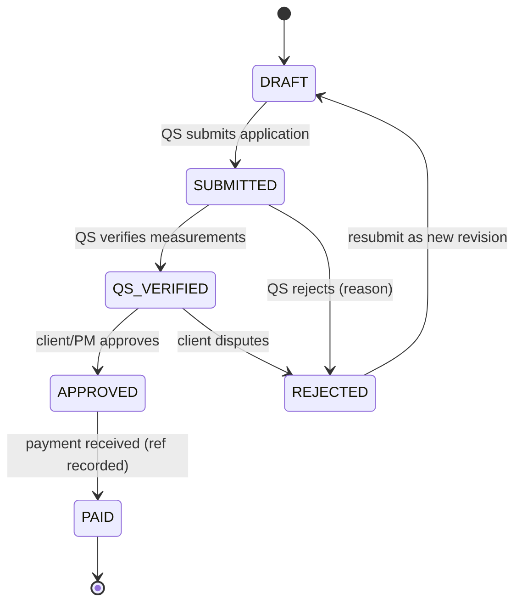
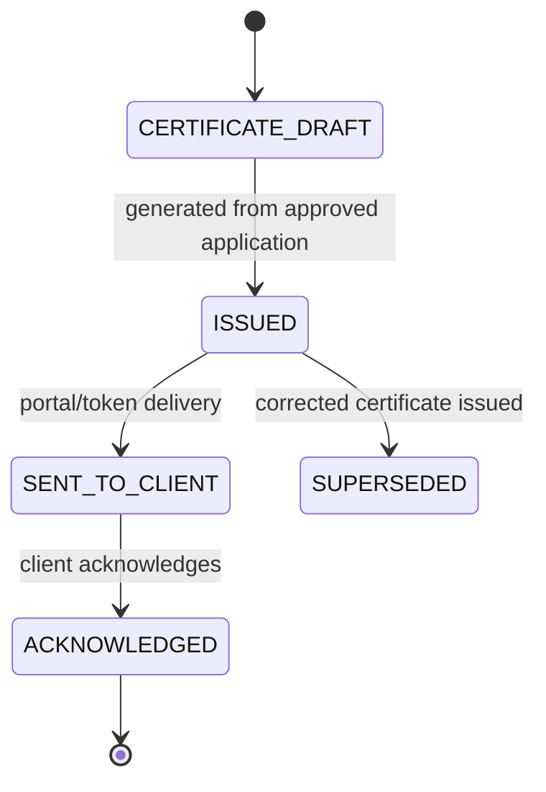

# ADR-008: Client payment certificates & retention ledger

**Status:** proposed · **Date:** 2026-11-06 · **Deciders:** owner + CTO · **Evidence:** `docs/research/console-audit/03_workflows/`, `04_journeys.md` J1/J6 [OBSERVED]

## Context

Observed competitor money spine [OBSERVED]: commitments → sub claims → payment applications (submit/approve/reject/mark-paid) → certificates → retention release → closeout. Our system generates IPC (interim payment certificate) PDFs on the fly (M10) with **no persisted entity** — meaning no approval state, no reconciliation trail, no client-visible certificate history. `SubcontractorValuation` covers only the subcontractor direction; the employer→client direction is missing.

Retention figures below (10% interim / 5% cap / 50-50 release) reflect common JBC contract terms **but are UNVERIFIED pending review by a practicing Kenyan QS** — treat as configurable defaults, not statutory fact.

## Options

- **A. New `payment_applications` + `certificates` + `retention_ledger` entities** for the client (employer) direction, mirroring the proven `SubcontractorValuation` shape.
- **B. Extend `VariationOrder`/`CostEntry`** — rejected: wrong lifecycle; variations ≠ valuations, and cost entries are internal spend.
- **C. PDFs only (status quo)** — rejected: no approval state machine, no reconciliation, audit gap; a disputed certificate cannot be reconstructed.
- **D. Single `certificate` entity covering both directions** — rejected for V1: client and subcontractor valuations have different approval chains and retention rules; unify later if a real need emerges.

## Decision

Option A.

- `payment_applications`: project, period, gross certified work, retention deducted, previous payments, withholding tax, net payable, status `DRAFT→SUBMITTED→QS_VERIFIED→APPROVED→PAID` / `REJECTED`, payment_reference, approved_by — same pattern as `SubcontractorValuation`.
- `certificates`: persisted IPC entity (number, period, amounts, PDF `storage_key`, status). PDF regenerates **from** the entity, never the reverse — entity is source of truth.
- `retention_ledger`: append-only hold/release entries per project — employer-side counterpart of `SubcontractorRetentionRelease`. Percentages configurable per project/contract; defaults flagged UNVERIFIED pending QS review.
- All money Decimal via `packages/money`; RLS FORCE; isolation + immutability tests; all transitions AuditLogged.

## State diagrams





## Data model & migration plan

```prisma
model PaymentApplication {
  id               String   @id @default(cuid())
  tenantId         String
  projectId        String
  applicationNo    String   // PAYAPP-YYYY-NNNN per tenant
  periodStart      DateTime
  periodEnd        DateTime
  grossCertified   Decimal
  retentionDeducted Decimal
  previousPayments Decimal
  withholdingTax   Decimal
  netPayable       Decimal
  status           PaymentApplicationStatus @default(DRAFT)
  paymentReference String?
  paidAt           DateTime?
  approvedById     String?
  approvedAt       DateTime?
  certificate      Certificate?
  createdAt        DateTime @default(now())
  updatedAt        DateTime @updatedAt
  @@unique([tenantId, applicationNo])
}

model Certificate {
  id            String   @id @default(cuid())
  tenantId      String
  projectId     String
  applicationId String?  @unique
  certificateNo String   // IPC-YYYY-NNNN
  periodLabel   String
  grossAmount   Decimal
  retentionHeld Decimal
  vatAmount     Decimal
  netAmount     Decimal
  pdfStorageKey String?
  status        CertificateStatus @default(DRAFT)
  issuedAt      DateTime?
  sentAt        DateTime?
  acknowledgedAt DateTime?
  createdAt     DateTime @default(now())
  @@unique([tenantId, certificateNo])
}

model RetentionLedgerEntry {
  id          String   @id @default(cuid())
  tenantId    String
  projectId   String
  certificateId String?
  entryType   String   // HOLD | RELEASE | ADJUSTMENT
  amount      Decimal  // signed
  balanceAfter Decimal
  reason      String?
  createdById String
  createdAt   DateTime @default(now())
  // append-only: no updatedAt; DB-level immutability per C4 pattern
}
```

**Migration:** new tables only + RLS policies in `rls.sql`. Existing on-the-fly IPC PDF route (M10) refactored to render from `Certificate` entity; legacy route kept read-only for pre-migration projects or backfilled as `ISSUED` certificates — decide at implementation after data audit. Retention defaults stored in `Project` config JSON or new columns — prefer explicit columns (`retentionPct`, `retentionCapPct`, `releaseInstallments`).

## Test plan

- Unit: net-payable math (gross − retention − previous − WHT), retention balance rollup.
- API: full state machine transitions, illegal-transition rejection, certificate generation from approved application only, retention hold/release append-only enforcement (UPDATE/DELETE denied at DB level like C4 fix).
- Tenant isolation: cross-tenant denial for all three tables.
- Client portal: only `SENT_TO_CLIENT`+ certificates visible; acknowledgement recorded.
- Regression: existing M10 IPC PDF tests must pass against entity-backed renderer.

## Consequences

- Client portal gains "Valuations" tab: certificates + retention balance + payment status.
- M-Pesa/B2C disbursement hooks later via existing `MpesaDisbursementTransaction`.
- Unified terminology internally: "IPC" = client certificate; `SubcontractorValuation` remains the sub direction.
- **UNVERIFIED:** retention percentages and release schedule must be validated against real JBC/contract terms by a practicing Kenyan QS before defaults ship.

## Open questions

- Does the employer-side retention release schedule differ from subcontractor side in practice? (QS review)
- Should `payment_applications` support negative adjustments (contra items)? Likely yes — design field now, enable later.
