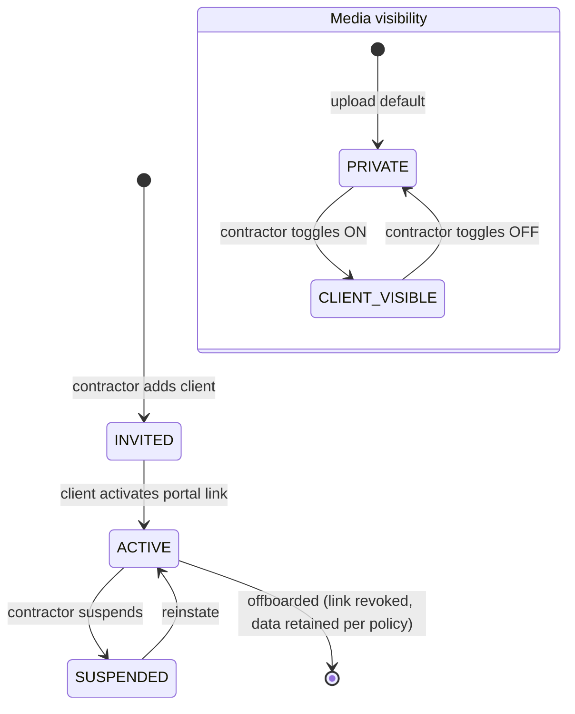

# ADR-009: Client visibility controls & ProjectClient entity

**Status:** proposed · **Date:** 2026-11-06 · **Deciders:** owner + CTO · **Evidence:** `docs/research/console-audit/03_workflows/`, `09_ux_findings.md` [OBSERVED]

## Context

Observed competitor UX detail [OBSERVED]: per-photo **"Show to client in portal"** toggle — internal issues (accidents, supplier problems, commercial disputes) stay private; written diary narrative notes are never client-visible; only curated media/updates cross the boundary. This is the trust mechanism that makes client transparency safe.

Our `SitePhoto` lacks a visibility flag and we have no structured per-project Client entity — portal access is token links only (`PortalAccessLink`), which cannot attribute approvals to a person or scope visibility per client.

## Options

- **A. `project_clients` entity + `site_photos.client_visible` boolean (default false) + diary-notes exclusion rule + per-document share flags.**
- **B. Token-only access (status quo)** — rejected: no client identity, no per-client scoping, no approval attribution; cannot support "which client saw/approved this" audit questions.
- **C. Share everything to portal** — rejected: privacy/KDPA 2019 risk (photos may contain identifiable persons), destroys contractor trust, leaks commercial information.
- **D. Per-client visibility matrices (role × module × item)** — over-engineered for V1; the observed product itself uses a simple per-item toggle. Revisit if enterprise clients demand granularity.

## Decision

Option A.

- `project_clients`: project_id, name, email/phone, role hint (owner/agent/tenant rep), status (INVITED/ACTIVE/SUSPENDED), linked `PortalAccessLink`(s).
- `site_photos.client_visible Boolean @default(false)` — **opt-in sharing; default OFF** (safer failure mode).
- `project_documents.client_visible Boolean @default(false)` — same pattern for shared documents.
- Visibility rule (server-enforced, not UI-only): client portal exposes ONLY `client_visible=true` photos/documents + explicitly published updates; `SiteDiary` narrative fields never exposed — only structured aggregates (headcounts, weather, status) if/when a client-safe diary summary is designed.
- Variations/certificates become client-visible at defined status transitions (per ADR-008/ADR-010), not by manual flag.
- KDPA 2019: photo consent note in privacy policy; defined retention/deletion path per Data Protection Act.

## State diagram



## Data model & migration plan

```prisma
model ProjectClient {
  id          String   @id @default(cuid())
  tenantId    String
  projectId   String
  name        String
  email       String?
  phone       String?
  roleHint    String?  // owner | agent | tenant_rep — free text V1
  status      ClientStatus @default(INVITED)
  portalLinks PortalAccessLink[]
  createdAt   DateTime @default(now())
  updatedAt   DateTime @updatedAt
}

// SitePhoto: + clientVisible Boolean @default(false)
// ProjectDocument: + clientVisible Boolean @default(false)
```

**Migration:** additive columns with `DEFAULT false` — zero behavior change for existing rows (all start private = safe). New `project_clients` table + RLS. Portal query layer (M9) updated to INNER JOIN/WHERE on `client_visible` — this is the critical change; existing portal endpoints must be audited one by one. Backfill: none needed (default private is correct).

## Test plan

- API: portal endpoint returns ONLY `client_visible=true` media — explicit test that a private photo ID returns 404/403 via client token.
- Toggle permission: only contractor-side roles can flip visibility; client cannot self-publish.
- Diary exclusion: assert no endpoint exposes diary narrative text to client tokens.
- KDPA: document deletion/retention path tested; consent copy reviewed.
- Regression: full M9 portal test suite updated + green.

## Consequences

- Client portal gains real identity + granular, auditable media sharing.
- Existing M9 portal queries must filter `client_visible` — migration + per-endpoint audit required (main cost of this ADR).
- Aligns with Kenya Data Protection Act 2019 obligations (R-009).
- Slight UX cost: contractor must curate photos — this is the intended trust trade-off, same as observed product.

## Open questions

- Should diary get a structured "client-safe daily summary" (headcount + weather + status only)? Candidate SHOULD feature; needs UX design.
- Multi-client projects (e.g. joint venture clients) — `project_clients` supports N rows; portal link scoping per client deferred.
