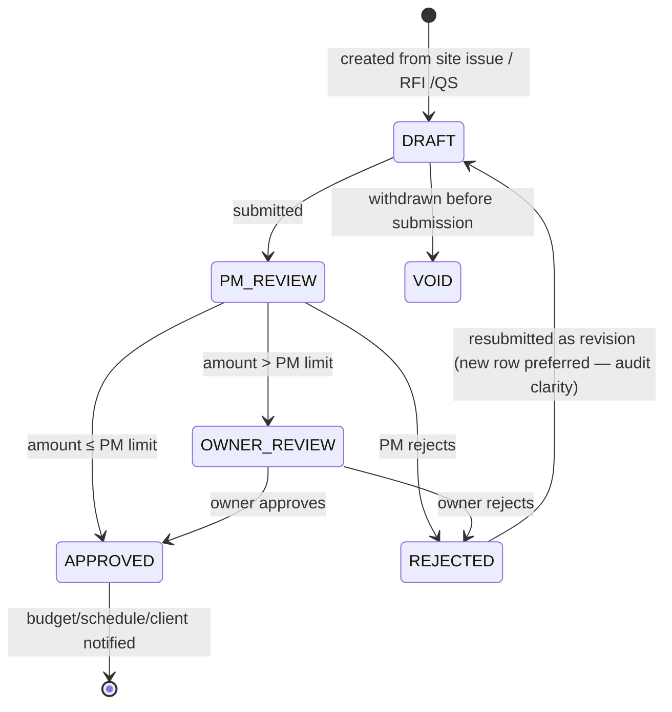

# ADR-010: Change-order / variation upgrade — triggers, assignees, approval limits

**Status:** proposed · **Date:** 2026-11-06 · **Deciders:** owner + CTO · **Evidence:** `docs/research/console-audit/02_roles_permissions.md`, `03_workflows/` [OBSERVED]

## Context

Observed competitor change orders carry [OBSERVED]: a trigger taxonomy (design clarification, owner request, unforeseen condition, code compliance, structural review, weather/delays, other), optional linked RFI, explicit cost + schedule impact fields, assignees, and a 3-stage approval chain (Drafted → PM Review → Owner Approval) with **per-role approval limits** — a PM can approve small COs, larger ones escalate to the owner.

Our `VariationOrder` has `SUBMITTED→QS_EVALUATED→APPROVED→REJECTED` with `net_amount`/`time_extension_days` but no trigger, no RFI link, no assignees, no owner-review stage, and no approval limits — meaning today any approver can approve any amount, which is not how real contracts work.

## Options

- **A. Extend `VariationOrder`** with trigger, `linked_rfi_id` (RFI models exist), cost/schedule impact fields, assignees via join table, extended status chain incl. `OWNER_REVIEW`, and `approval_limit_minor` on role/membership config.
- **B. New `ChangeOrder` model parallel to variations** — rejected: duplicate concept for the same real-world instrument; doubles migration + UI cost; "variation order" and "change order" are the same thing in Kenyan practice (VO/CO used interchangeably on JBC contracts).
- **C. Keep as-is** — rejected: misses the approval-limit control that makes CO approvals trustworthy and auditable; a PM self-approving a KES 5M variation is a real commercial risk.

## Decision

Option A — `VariationOrder` IS our change-order engine.

- Add fields: `trigger_type` (enum), `linked_rfi_id` (nullable FK), `cost_impact_minor`, `schedule_impact_days` (reuse existing `time_extension_days` semantics — verify before adding duplicate), `requested_by_id`, assignees via `variation_assignees` join to `ProjectMember`.
- Statuses extended: `DRAFT → PM_REVIEW → OWNER_REVIEW → APPROVED | REJECTED | VOID`. Migration maps legacy values: `SUBMITTED→PM_REVIEW`, `QS_EVALUATED→PM_REVIEW` (QS evaluation folded into PM review stage w/ comment), `APPROVED→APPROVED`, `REJECTED→REJECTED`.
- `approval_limit_minor` (integer minor units, KES) configurable per membership/role on company settings; **enforced server-side in the transition endpoint** — UI hiding is cosmetic only.
- Escalation rule: if `abs(net_amount) > approver's limit` → auto-route to `OWNER_REVIEW`; owner/executive role has configurable or unlimited limit.
- All transitions audit-logged via existing `AuditLog` (who, when, from→to, amount at time of approval).

## State diagram



## Data model & migration plan

```prisma
model VariationOrder {
  // ... existing fields ...
  triggerType     VariationTrigger?   // DESIGN_CLARIFICATION | OWNER_REQUEST | UNFORESEEN_CONDITION | CODE_COMPLIANCE | STRUCTURAL_REVIEW | WEATHER_DELAY | OTHER
  linkedRfiId     String?
  costImpactMinor BigInt?             // explicit impact separate from net_amount
  requestedById   String?
  status          VariationStatus     // extended enum — see mapping above
  assignees       VariationAssignee[]
}

model VariationAssignee {
  variationOrderId String
  projectMemberId  String
  role            String  // REVIEWER | APPROVER
}

// CompanySetting or Membership: approvalLimitMinor BigInt?  (null = unlimited, owner-only roles)
```

**Migration:** enum extension + new nullable columns + join table — additive, no data loss. Status remap in same migration (`UPDATE` with explicit CASE). Backfill `trigger_type` as `OTHER` for legacy rows. Approval limits: new nullable column defaulting NULL (= current behavior, no limit) — **safe rollout**: limits only bite once the company configures them.

## Test plan

- Unit: limit-escalation logic (amount vs limit boundary — exactly-at-limit approves, limit+1 escalates).
- API: each transition permission-checked; PM cannot force-approve above limit even via direct API call (server-side enforcement test); owner approval required path; audit rows per transition.
- Regression: existing variation tests updated for new statuses; M9 client pending-variations UI shows `OWNER_REVIEW` state.
- Tenant isolation on new join table.

## Consequences

- Client portal shows COs awaiting owner approval — matches observed product's client approval step.
- PM/QS approval limit becomes a company setting — needs settings UI (small).
- Existing variation tests need updates for new statuses (known cost).
- Trigger taxonomy improves reporting (variations by cause) — feeds future analytics.

## Open questions

- Should rejection require a mandatory reason? (Recommend yes — audit quality.)
- Time-impact approval: does schedule extension need separate approval from cost? JBC contracts often treat them together — confirm with QS.
- Decimal vs BigInt for `approval_limit_minor` — codebase uses integer minor units per ADR-005; confirm consistency.
