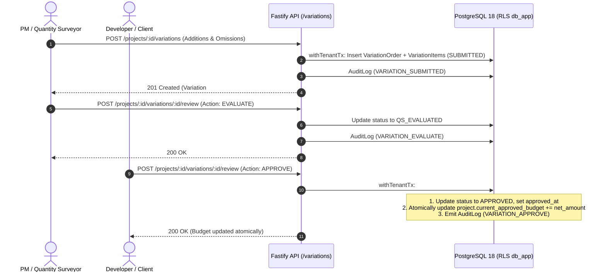

# Milestone M8 Completion Report: Contractual Variations Workflow

**Status:** Completed & Self-Verified  
**Date:** 2026-11-03  
**Product:** MjengoLedger  
**Test Suite Status:** 118/118 passing tests across monorepo (100% green builds, 0 type errors)

---

## 1. Executive Summary

Milestone M8 delivers the contractual variations workflow for MjengoLedger, formalizing additions and omissions to the project scope and maintaining the fundamental financial invariant:

$$\text{Current Approved Budget} = \text{Original BOQ Budget} + \sum \text{Approved Variations}$$

Variations can only be requested by PM/QS or Admin, evaluated by QS, and approved by the Client or Admin. Upon client approval, the approved budget is atomically updated inside `withTenantTx` with an append-only audit trail. Finalized variations become immutable.

---

## 2. Implemented Architecture & Workflow

---

## 3. Key Components Implemented

### 3.1. Validation Schemas ([`packages/validation/src/index.ts`](file:///home/maskgod/Documents/FRONT_END_WEB_DEVELOPMENT_COURSE/Construction/packages/validation/src/index.ts))
- `VariationQuantitySchema`: Supports signed decimal quantities (positive for additions, negative for omissions) with up to 4 decimal places (`/^-?\d+(\.\d{1,4})?$/`).
- `VariationItemInputSchema`: Validates section, description, unit, quantity, unit rate, and optional linked BOQ item.
- `CreateVariationOrderSchema`: Validates title, scope description, reason, days extension, and array of variation items.
- `ReviewVariationOrderSchema`: Validates action (`EVALUATE`, `APPROVE`, `REJECT`) and optional review notes.

### 3.2. Fastify REST Endpoints ([`apps/api/src/routes/variations.ts`](file:///home/maskgod/Documents/FRONT_END_WEB_DEVELOPMENT_COURSE/Construction/apps/api/src/routes/variations.ts))
- `GET /api/v1/projects/:projectId/variations`: Lists variation orders with item breakdowns, scoped to active tenant.
- `GET /api/v1/projects/:projectId/variations/:variationId`: Single order details with linked BOQ references.
- `POST /api/v1/projects/:projectId/variations`:
  - Sequence generator: Automatically increments `variation_no` per project.
  - Money calculations: Computes item line totals and total `net_amount` using `@construction/money`.
  - Audit logging: Append-only audit record `VARIATION_SUBMITTED`.
- `POST /api/v1/projects/:projectId/variations/:variationId/review`:
  - `EVALUATE`: Requires `Permissions.VARIATION_REVIEW` (PM_QS).
  - `APPROVE`: Requires `Permissions.VARIATION_APPROVE` (CLIENT/Admin). Atomically increments `project.current_approved_budget` by `variation.net_amount`.
  - `REJECT`: Rejects order, leaving contract budget unaltered.
  - Immutability check: Prevents modification of already finalized orders.

### 3.3. React 19 Frontend Components
- [`CreateVariationModal.tsx`](file:///home/maskgod/Documents/FRONT_END_WEB_DEVELOPMENT_COURSE/Construction/apps/web/src/components/CreateVariationModal.tsx): Interactive modal with per-item `+ Addition` / `- Omission` toggles, real-time line total calculation, and live net amount summary.
- [`VariationManagementView.tsx`](file:///home/maskgod/Documents/FRONT_END_WEB_DEVELOPMENT_COURSE/Construction/apps/web/src/components/VariationManagementView.tsx): Filterable variation register with status badges, net KES impact, extension days, expandable line item breakdown, and role-appropriate action buttons (`Evaluate`, `Approve`, `Reject`).
- Integrated into [`PmQsDashboard.tsx`](file:///home/maskgod/Documents/FRONT_END_WEB_DEVELOPMENT_COURSE/Construction/apps/web/src/components/PmQsDashboard.tsx) and [`ClientDashboard.tsx`](file:///home/maskgod/Documents/FRONT_END_WEB_DEVELOPMENT_COURSE/Construction/apps/web/src/components/ClientDashboard.tsx).

---

## 4. Test & Verification Matrix

All 118 monorepo tests executed cleanly against PostgreSQL 18 with Row-Level Security:

| Suite | Tests | Status | Key Verifications |
|---|---|---|---|
| `m8-variations.test.ts` | 15 | Passed | Additions, omissions, net amounts, sequence generator, QS evaluation, Client approval, atomic budget update, rejection, immutability, RBAC least privilege, RLS isolation, rollback atomicity |
| `m7-variance.test.ts` | 13 | Passed | Variance analytics, latest progress pickup, neutrality regex, RLS multi-tenancy |
| `m6-site.test.ts` | 13 | Passed | Site diary, photo compression, progress recording, offline queue, idempotency |
| `m5-costs.test.ts` | 15 | Passed | Cost ledger, Decimal budget aggregation, approval workflow, receipts |
| `m4-boq.test.ts` | 8 | Passed | Staged Excel import, arithmetic discrepancy checks, BOQ versioning |
| `m3-company-projects.test.ts` | 11 | Passed | Invitations, memberships, projects, role-scoped metrics |
| `isolation.test.ts` | 8 | Passed | PostgreSQL RLS with FORCE, non-superuser role `db_app`, catalog verification |
| `auth.test.ts` | 8 | Passed | Session JWT, cookies, login, logout, me |
| `App.test.tsx` (web) | 19 | Passed | React 19 dashboards, VariationManagementView, CreateVariationModal, VarianceMonitorCard |
| `@construction/money` | 13 | Passed | Half-up rounding, addition/omission line totals, sub-cent test vectors |
| `@construction/permissions` | 4 | Passed | Role-permission mappings, least-privilege checks |
| `@construction/db` | 2 | Passed | Client initialization and tenant transaction wrapper |

---

## 5. Security & Invariant Adherence

- **Financial Integrity**: Zero JavaScript floating-point arithmetic; all calculations performed in `Decimal` via `@construction/money`.
- **Fail-Closed Tenancy**: Every query runs inside `withTenantTx` setting `app.current_tenant_id` under unprivileged role `db_app`.
- **Audit Logging**: Every state change produces an immutable audit record in `audit_logs`.
- **Neutral Language**: Zero derogatory or accusatory phrasing.
