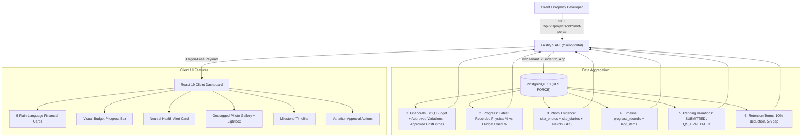

# Milestone M9 Completion Report: Client & Developer Portal

**Status:** Completed & Self-Verified  
**Date:** 2026-11-03  
**Product:** MjengoLedger  
**Test Suite Status:** 137/137 passing tests across monorepo (100% green builds, 0 type errors)

---

## 1. Executive Summary

Milestone M9 delivers the dedicated **Client / Property Developer Portal** for MjengoLedger, tailored for private investors, commercial developers, and property owners. The portal replaces fragmented WhatsApp photo updates and opaque contractor spreadsheets with an executive, jargon-free view of project health:

1. **5 Transparent Financial Numbers**: Computed in arbitrary precision `Decimal` via `@construction/money`.
2. **Neutral Health & Alignment Guard**: Automated comparison of budget consumption % vs recorded physical progress % with zero accusatory language (`ON_TRACK`, `ATTENTION`, `ACTION_REQUIRED`).
3. **Geotagged Photo Evidence Gallery**: Verified site photos with Nairobi GPS coordinates (`latitude`, `longitude`), timestamps, weather conditions, inspector sign-offs, and an interactive inspection Lightbox modal.
4. **Milestone Progress Timeline**: Chronological progress milestones linked to BOQ sections with progress percentage badges and inspector notes.
5. **Contractual Variations Action Center**: Direct review and approval/rejection capability for client-facing change orders, with atomic budget updates upon sign-off.
6. **Kenyan Standard Retention Terms**: Transparent display of the statutory 10% interim deduction, 5% maximum cap, and 50/50 release milestones (Practical Completion and Defects Liability Period).

---

## 2. Implemented Architecture & Data Flow

---

## 3. Key Components Implemented

### 3.1. Dedicated REST Endpoint ([`apps/api/src/routes/clientPortal.ts`](file:///home/maskgod/Documents/FRONT_END_WEB_DEVELOPMENT_COURSE/Construction/apps/api/src/routes/clientPortal.ts))
- Endpoint: `GET /api/v1/projects/:projectId/client-portal`
- Guarded by `server.authenticate` and `Permissions.PROJECT_VIEW`.
- Restricts unprivileged roles (e.g. `SITE_SUPERVISOR` receives 403 Forbidden).
- Scoped strictly by PostgreSQL RLS inside `withTenantTx`.
- Computes the 5 plain-language financial numbers:
  - `original_agreed_budget`
  - `approved_variations_total`
  - `current_approved_budget`
  - `total_spent_to_date`
  - `remaining_balance`
  - `budget_used_percentage`
- Computes progress and neutral health status:
  - `physical_progress_percentage`
  - `variance_delta`
  - `health_status` (`ON_TRACK` / `ATTENTION` / `ACTION_REQUIRED`)
  - `health_notice`
- Gathers verified geotagged photos from `site_photos` joined with `site_diaries`.
- Gathers chronological progress history from `progress_records` joined with `boq_items`.
- Filters pending variations requiring client approval (`SUBMITTED` and `QS_EVALUATED`).
- Formats Kenyan standard retention terms.

### 3.2. React 19 Frontend Components
- [`ClientDashboard.tsx`](file:///home/maskgod/Documents/FRONT_END_WEB_DEVELOPMENT_COURSE/Construction/apps/web/src/components/ClientDashboard.tsx): Executive dashboard combining the 5 financial cards, visual budget bar, neutral health alert, retention fund terms, and integrated variation management.
- [`PhotoEvidenceGallery.tsx`](file:///home/maskgod/Documents/FRONT_END_WEB_DEVELOPMENT_COURSE/Construction/apps/web/src/components/PhotoEvidenceGallery.tsx): Responsive photo grid with Nairobi GPS location badges (`📍 -1.286389, 36.817223`), timestamps, weather conditions, inspector sign-offs, and click-to-enlarge.
- [`PhotoLightboxModal.tsx`](file:///home/maskgod/Documents/FRONT_END_WEB_DEVELOPMENT_COURSE/Construction/apps/web/src/components/PhotoLightboxModal.tsx): Fullscreen inspection modal displaying high-res site photo, Nairobi GPS pin, weather badge, verification signature, and date.
- [`MilestoneTimeline.tsx`](file:///home/maskgod/Documents/FRONT_END_WEB_DEVELOPMENT_COURSE/Construction/apps/web/src/components/MilestoneTimeline.tsx): Vertical chronological timeline showing progress percentage badges (`100%`, `50%`, `20%`), BOQ section references, and inspector notes.

---

## 4. Test & Verification Matrix

All 137 tests pass cleanly across 15 suites in the monorepo:

| Suite | Tests | Status | Key Verifications |
|---|---|---|---|
| `m9-client-portal.test.ts` | 13 | Passed | 5 Decimal numbers, budget used %, GPS geotagged photo evidence, milestone timeline, pending variations, neutrality regex check, Kenyan retention terms, RLS multi-tenant isolation, role permission guards |
| `m8-variations.test.ts` | 15 | Passed | Additions, omissions, net amounts, sequence generator, QS evaluation, Client approval, atomic budget update, rejection, immutability, RBAC least privilege, RLS isolation |
| `m7-variance.test.ts` | 13 | Passed | Variance analytics, latest progress pickup, neutrality regex, RLS multi-tenancy |
| `m6-site.test.ts` | 13 | Passed | Site diary, photo compression, progress recording, offline queue, idempotency |
| `m5-costs.test.ts` | 15 | Passed | Cost ledger, Decimal budget aggregation, approval workflow, receipts |
| `m4-boq.test.ts` | 8 | Passed | Staged Excel import, arithmetic discrepancy checks, BOQ versioning |
| `m3.test.ts` / `m3-company-projects.test.ts` | 20 | Passed | Invitations, memberships, projects, role-scoped metrics |
| `isolation.test.ts` | 8 | Passed | PostgreSQL RLS with FORCE, non-superuser role `db_app`, catalog verification |
| `auth.test.ts` | 8 | Passed | Session JWT, cookies, login, logout, me |
| `App.test.tsx` (web) | 25 | Passed | React 19 dashboards, Client Portal 5 financial cards, GPS PhotoEvidenceGallery, LightboxModal, MilestoneTimeline, VariationManagementView |
| `@construction/money` | 13 | Passed | Half-up rounding, addition/omission line totals, sub-cent test vectors |
| `@construction/permissions` | 4 | Passed | Role-permission mappings, least-privilege checks |
| `@construction/db` | 2 | Passed | Client initialization and tenant transaction wrapper |

---

## 5. Security & Invariant Adherence

- **Financial Integrity**: All arithmetic uses `Decimal` from `@construction/money`. Zero floating-point drift.
- **Fail-Closed Tenancy**: Every query runs inside `withTenantTx` with `app.current_tenant_id` under `db_app`.
- **Strict Neutrality**: The system strictly reports verified arithmetic facts; zero inflammatory or accusatory phrasing.
- **Contractual Clarity**: Clear separation between contractor internal costs and client-facing verified expenditures.
