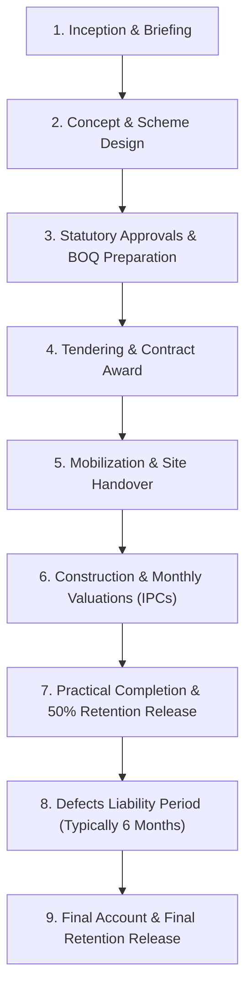

# Research Report 02: Kenyan Construction Workflow & Industry Conventions

**Access Date:** 2026-10-27  
**Scope:** Project lifecycle stages, Bill of Quantities (BOQ) structure and measurement standards (EASMM), Interim Payment Certificate (IPC) mechanics, retention ledger rules with a worked 4-certificate numeric example, variations procedure, final account settlement, standard contract forms, and stakeholder approval hierarchy in Kenya.

---

## 1. Project Lifecycle Stages in Kenya

A formal building project in Kenya follows nine standard stages, recognized under the Joint Building Council (JBC) contract framework and Architectural Association of Kenya (AAK) practice standards [Tag: `UNVERIFIED — GENERAL INDUSTRY PRACTICE`]:

1. **Inception & Briefing:** Client defines project brief, site parameters, and preliminary budget. Lead consultant (typically the Architect) is engaged.
2. **Concept & Scheme Design:** Architect and Engineers produce schematic and detailed designs; Quantity Surveyor (QS) establishes preliminary cost estimates.
3. **Statutory Approvals & BOQ Preparation:** Architectural and engineering drawings are submitted for County Government building approval (PPA2 form) and National Construction Authority (NCA) project registration. The appointed QS produces the Bill of Quantities (BOQ) based on approved detailed drawings.
4. **Tendering & Contract Award:** Contractors submit competitive bids based on the unpriced BOQ. The QS prepares a Tender Evaluation Report. The Client awards the contract, and parties execute a formal agreement (commonly the JBC Standard Form of Building Contract).
5. **Mobilization & Site Handover:** Client/Lead Consultant formally hands over the physical site. The contractor submits the project work program/schedule and any required performance security.
6. **Construction & Valuation (The Core Execution Loop):**
   - Daily site diary, labor attendance, and material delivery logs recorded on site.
   - Monthly joint site measurement by Contractor and QS.
   - Issuance of an Interim Payment Certificate (IPC) by the Lead Consultant/Project Manager.
   - Client disbursement within the contractual payment window (commonly 14 calendar days).
7. **Practical Completion:** When works are substantially complete and fit for occupation, the Lead Consultant issues the **Certificate of Practical Completion**. The first moiety (50%) of accrued retention is certified for release.
8. **Defects Liability Period (DLP):** Standard period (commonly 6 months, or 12 months for complex installations) during which the contractor remains contractually obligated to rectify defects or snags at their own expense.
9. **Final Account Settlement:** QS reconciles all variations, provisional sums, and remeasurements into a final account. Following satisfactory snag rectification, the **Certificate of Making Good Defects** is issued, followed by the **Final Payment Certificate**, releasing the final 50% of retention.

---

## 2. BOQ Structure and Measurement Conventions (EASMM)

### 2.1 Governing Measurement Standard
In Kenya, the formal measurement of building works is governed by the **Standard Method of Measurement of Building Works and Associated Civil Works for Eastern Africa (EASMM)**, Second Edition (June 2008), published by the AAK Quantity Surveyors Chapter and recognized by BORAQS and IQSK [Tag: `UNVERIFIED — PRINT PUBLICATION STANDARD`].

### 2.2 Standard BOQ Sections & Layout
Kenyan BOQs follow a trade/element hierarchy:

| Section | Content & Function | Financial Role in SaaS |
|---|---|---|
| **Section 1: Preliminaries** | General conditions, site security, insurances, water/power for the works, scaffolding, temporary sheds, plant. | Often fixed lump sums or time-related sums; drawdown occurs progressively rather than strictly per measured unit. |
| **Section 2: Substructure** | Earthworks, bulk and trench excavation, disposal, hardcore bed, termite treatment, damp-proof membrane (DPM), foundation concrete, foundation masonry. | Measured works; quantities measured net in place. |
| **Section 3: Superstructure** | Reinforced concrete frame (columns, beams, slabs, stairs), walling (machine-cut quarry stone or precast blocks), structural steel, roof carpentry and roof covering. | Primary measured trade items with strict `Quantity × Rate = Amount`. |
| **Section 4: Finishes** | Floor screeds and tiling, wall plastering and rendering, ceiling finishes, internal and external painting. | Surface area measurements ($m^2$). |
| **Section 5: Openings** | Timber doors, steel security doors, aluminum/UPVC casement windows, glazing, ironmongery. | Measured by count ($No.$) or surface area. |
| **Section 6: Mechanical & Electrical (M&E)** | Sanitary installations, internal plumbing, foul drainage, electrical conduit, wiring, consumer units. | Mixed: itemized schedule items alongside Prime Cost allowances. |
| **Section 7: External Works** | Perimeter boundary walls, entry gates, cabro paving, storm-water drainage, septic tank / soak pit, landscaping. | Measured trade sections. |
| **Section 8: Prime Cost (PC) & Provisional Sums** | Contingency sum, specialist subcontract sums (e.g., lifts, specialized HVAC), utility connection allowances. | Discretionary allowances adjusted via approved variation instructions. |
| **Grand Summary** | Summarizes subtotals from Preliminaries, Bills 2–8, Contingencies, and 16% VAT calculation. | The contractual baseline budget. |

### 2.3 Measurement Rules
- **Net Measurement:** EASMM mandates that items are measured net as fixed in position. No allowance for cutting, waste, or lap is included in measured quantities; contractors must reflect waste factors inside their unit rates [Tag: `UNVERIFIED — GENERAL INDUSTRY PRACTICE`].
- **Standard Units:** Metric units strictly apply (`m`, `m2`, `m3`, `Kg`, `Ton`, `No.`, `Item`).

---

## 3. Interim Payment Certificates (IPCs) & Retention

> [!WARNING]
> **Status:** `UNVERIFIED — TO BE VALIDATED BY A PRACTICING QS IN DISCOVERY INTERVIEWS` (Remediation Plan R-015)  
> The mathematical structure below reflects standard Kenyan building contract practice. Because contract details vary by project appendix, this exact formula must be confirmed with a practicing QS during Discovery Gate interviews before building valuation features. Contract clause numbers are deliberately not hard-coded.

### 3.1 The Retention Ledger Formulation (G1)
Retention operates as an **append-only ledger** of deductions and releases. Modeling retention simply as $\min(\text{rate} \times \text{Gross}, \text{cap})$ fails after Practical Completion because it ignores releases already disbursed to the contractor:

$$\begin{aligned}
\text{Gross Valuation to Date} &= \text{Measured Work Completed to Date} \\
&+ \text{Approved Variations Completed to Date} \\
&+ \text{Eligible Unfixed Materials on Site (e.g., 80\% of invoice value)} \\[6pt]
\text{Gross Retention Target to Date} &= \min\Big(\text{Gross Valuation to Date} \times \text{Retention \%},\; \text{Retention Cap Limit}\Big) \\[6pt]
\mathbf{\text{Retention Held to Date}} &= \mathbf{\text{Gross Retention Target to Date} - \text{Cumulative Retention Released to Date}} \\[6pt]
\text{Net Valuation to Date} &= \text{Gross Valuation to Date} - \text{Retention Held to Date} \\[6pt]
\mathbf{\text{Current Certificate Amount Due}} &= \mathbf{\text{Net Valuation to Date} - \text{Cumulative Net Previously Certified}}
\end{aligned}$$

---

### 3.2 Worked Numeric Example (Certificates 01 through 04)

**Project Parameters:**
- **Original Contract Sum:** KES 10,000,000.00
- **Retention Rate:** 10.0% of Gross Valuation
- **Limit of Retention Fund (Cap):** 5.0% of Contract Sum = **KES 500,000.00**
- **Payment Window:** 14 calendar days from presentation of certificate

#### Month 1: Certificate No. 01
1. Measured work completed to date: KES 1,800,000.00
2. Materials on site (80% of KES 250,000): KES 200,000.00
3. **Gross Valuation to Date:** KES 2,000,000.00
4. Gross Retention Target: $10\% \times \text{KES } 2,000,000.00 = \text{KES } 200,000.00$  
   *(Since KES 200,000 < KES 500,000 cap; Released = KES 0)*
5. **Retention Held to Date:** $\text{KES } 200,000.00 - \text{KES } 0.00 = \text{KES } 200,000.00$
6. **Net Valuation to Date:** $\text{KES } 2,000,000.00 - \text{KES } 200,000.00 = \text{KES } 1,800,000.00$
7. Cumulative Net Previously Certified: KES 0.00
8. **Amount Due on Certificate No. 01:** **KES 1,800,000.00**  
   *(Retention held in reserve: KES 200,000.00)*

#### Month 2: Certificate No. 02
1. Measured work completed to date: KES 4,200,000.00
2. Materials on site: KES 300,000.00
3. **Gross Valuation to Date:** KES 4,500,000.00
4. Gross Retention Target: $10\% \times \text{KES } 4,500,000.00 = \text{KES } 450,000.00$  
   *(Since KES 450,000 < KES 500,000 cap; Released = KES 0)*
5. **Retention Held to Date:** $\text{KES } 450,000.00 - \text{KES } 0.00 = \text{KES } 450,000.00$
6. **Net Valuation to Date:** $\text{KES } 4,500,000.00 - \text{KES } 450,000.00 = \text{KES } 4,050,000.00$
7. Cumulative Net Previously Certified: KES 1,800,000.00
8. **Amount Due on Certificate No. 02:** $\text{KES } 4,050,000.00 - \text{KES } 1,800,000.00 = \mathbf{\text{KES } 2,250,000.00}$  
   *(Cumulative retention held in reserve: KES 450,000.00)*

#### Month 3: Certificate No. 03 (Retention Cap Reached)
1. Measured work completed to date: KES 6,800,000.00
2. Approved variations to date: KES 200,000.00
3. **Gross Valuation to Date:** KES 7,000,000.00
4. Gross Retention Target: $10\% \times \text{KES } 7,000,000.00 = \text{KES } 700,000.00$.  
   **Cap check:** Retention target is capped at **KES 500,000.00** (Released = KES 0).
5. **Retention Held to Date:** $\text{KES } 500,000.00 - \text{KES } 0.00 = \text{KES } 500,000.00$
6. **Net Valuation to Date:** $\text{KES } 7,000,000.00 - \text{KES } 500,000.00 = \text{KES } 6,500,000.00$
7. Cumulative Net Previously Certified: KES 4,050,000.00
8. **Amount Due on Certificate No. 03:** $\text{KES } 6,500,000.00 - \text{KES } 4,050,000.00 = \mathbf{\text{KES } 2,450,000.00}$  
   *(Cumulative retention held in reserve: KES 500,000.00 [Max Cap])*

#### Stage 7: Practical Completion (First Moiety Release)
1. Project reaches Practical Completion; Certificate of Practical Completion issued.
2. **First Moiety Release (50% of retention fund):**  
   $50\% \times \text{KES } 500,000.00 = \mathbf{\text{KES } 250,000.00}$ disbursed to the contractor.
3. Cumulative Retention Released to date: **KES 250,000.00**.
4. Retention remaining held in reserve: $\text{KES } 500,000.00 - \text{KES } 250,000.00 = \mathbf{\text{KES } 250,000.00}$.

#### Month 4 / Snagging: Certificate No. 04 (Post-Practical Completion — G1 Test Vector)
1. Final remeasured work and minor post-completion items bring cumulative gross valuation to: **KES 9,000,000.00**.
2. Gross Retention Target: $10\% \times \text{KES } 9,000,000.00 = \text{KES } 900,000.00 \rightarrow$ capped at **KES 500,000.00**.
3. **Retention Held to Date:** $\text{Gross Target (KES 500,000)} - \text{Released to Date (KES 250,000)} = \mathbf{\text{KES } 250,000.00}$.
4. **Net Valuation to Date:** $\text{KES } 9,000,000.00 - \text{KES } 250,000.00 = \mathbf{\text{KES } 8,750,000.00}$.
5. Cumulative Net Previously Certified: KES 6,500,000.00 (from Certificate 03).
6. **Amount Due on Certificate No. 04:**  
   $\text{KES } 8,750,000.00 - \text{KES } 6,500,000.00 = \mathbf{\text{KES } 2,250,000.00}$.  
   *(Notice: This correctly incorporates KES 2,000,000 in new gross work plus the KES 250,000 release from Practical Completion without under-paying the contractor).*

#### Stage 9: End of Defects Liability Period (Second Moiety Release)
1. Contractor rectifies all snags; Certificate of Making Good Defects issued.
2. **Second Moiety Release:** Remaining KES 250,000.00 is released in the Final Certificate, reducing retention reserve to KES 0.00.

---

### 3.3 Tax Treatment, Cap Base & Rounding Edge Cases (G2, G3, G4)

> [!NOTE]
> The following parameters represent Kenyan industry practice and must be validated with practicing QSs during Discovery Gate interviews:

1. **VAT Treatment (G2):**
   - BOQ unit rates in Kenya are universally quoted **exclusive of VAT**.
   - Standard 16% VAT is applied at the certificate level on the certified net amount due.
   - *Withholding Tax:* Clients who are appointed tax agents deduct withholding tax (typically 3% on construction contracts for resident contractors under Section 35 of the Income Tax Act) and withholding VAT (2%) at the time of **payment disbursement**, not within the QS certificate arithmetic.
2. **Retention Cap Base (G3):**
   - Standard JBC contracts specify the retention limit as 5% of the "Contract Sum".
   - *Open Interview Question for QS:* Does the 5% cap apply strictly to the original contract sum, or does it float with the revised contract sum when major approved variations expand the project scope?
3. **Negative Certificates & Rounding (G4):**
   - *Omission Variations:* If large omissions occur late in a project, the net valuation to date can drop below the cumulative previously certified amount, resulting in a negative certificate amount due (contractor refund or deduction against future claims).
   - *Rounding Mode:* Standard `Round Half-Up` to 2 decimal places (KES cents). Rounding occurs at the certificate total level, not on line-item sub-calculations, to avoid cumulative rounding drift.

---

## 4. Variations & Final Account

### 4.1 Variations Protocol
1. **Instruction:** Variations must originate from a formal written instruction issued by the Architect or Lead Consultant. Verbal site requests carry no contractual force under standard contract forms [Tag: `UNVERIFIED — GENERAL INDUSTRY PRACTICE`].
2. **Valuation Principles:**
   - Work of similar character carried out under similar conditions is valued at original BOQ rates.
   - Work not of similar character is valued using pro-rata rates derived from BOQ rates.
   - Work that cannot be reasonably measured or priced at BOQ rates is priced as Dayworks (vouched timesheets for labor + verified material invoices + agreed percentage markup).
3. **Approval:** A financial variation altering the contract sum must be evaluated by the QS and formally approved by the Client before certification.

### 4.2 Final Account Settlement
Following Practical Completion, the QS prepares the draft Final Account reconciling:
- Adjustments to Preliminaries.
- Remeasurement of provisional quantities (foundations, earthworks, external drainage).
- Net additions and omissions from approved variation orders.
- Actual expenditure against Prime Cost and Provisional sums.
Upon mutual agreement and signature by Contractor and Lead Consultant, the Final Payment Certificate is issued.

---

## 5. Standard Forms of Contract in Kenya

1. **Joint Building Council (JBC) Standard Form of Building Contract:**
   - Published under the sanction of the Architectural Association of Kenya (AAK) and Kenya Association of Building and Civil Engineering Contractors (KABCEC).
   - Available as "With Quantities" (BOQ forms part of contract) and "Without Quantities" (lump-sum based on drawings and specifications).
   - Forms the legal baseline for private commercial building projects in Kenya [Tag: `UNVERIFIED — GENERAL INDUSTRY PRACTICE`].
2. **PPRA Standard Tender Documents (PPADA 2015):**
   - Issued by the Public Procurement Regulatory Authority under the Public Procurement and Asset Disposal Act 2015.
   - Mandatory for all government, parastatal, and public institutional building works in Kenya [Tag: `UNVERIFIED — STATUTORY TENDER FRAMEWORK`].
3. **FIDIC Conditions of Contract:**
   - Used for major infrastructure, roads, and civil engineering projects financed by multinational development banks (World Bank, AfDB) [Tag: `UNVERIFIED — INTERNATIONAL CONTRACT FORMS`].

---

## 6. Stakeholder Approval Hierarchy

| Role in Project | Legal / Contractual Responsibility | What They Approve / Issue in Software |
|---|---|---|
| **Client / Employer** | Finances project, owns site, executes main contract | Project budget, contract award, variations increasing budget, payment releases. |
| **Architect / Lead Consultant** | Design, statutory County compliance, contract administration | Written instructions, Extensions of Time (EOT), Interim Payment Certificates (IPCs), Practical Completion Certificate. |
| **Quantity Surveyor (QS)** | Cost estimation, BOQ preparation, measurement of works, valuations | BOQ baseline import, interim monthly valuations, variation costings, material on-site allowances, Final Account. |
| **Structural / Services Engineer** | Structural integrity, M&E designs | Structural revision approvals, concrete pour inspection approvals. |
| **Contractor Project Manager** | Execution of works, site safety, subcontracts | Payment claims, variation requests, weekly progress reports, material orders. |
| **Site Supervisor / Foreman** | Daily field supervision, labor attendance, material deliveries | Daily site diary, daily labor headcount, delivery receipts, site progress photos. |
