# 05 — Inferred data model (ERD)

Inferred from API paths, form fields, list columns. `[INFERRED]` throughout — refine during Gate 2.

```mermaid
erDiagram
    COMPANY ||--o{ USER : has
    COMPANY ||--o{ PROJECT : owns
    COMPANY ||--o{ CONTACT : directory
    COMPANY ||--o{ CREW : employs
    COMPANY ||--o{ SUBCONTRACTOR : engages
    COMPANY ||--o{ EQUIPMENT : owns
    COMPANY ||--o{ INVENTORY_ITEM : stocks
    COMPANY ||--o{ DOCUMENT : stores
    COMPANY ||--o{ ANNOUNCUSSION : posts
    COMPANY ||--o{ SUBSCRIPTION : billed

    USER }o--o{ PROJECT : assigned
    USER ||--o{ CREW : foreman_of
    USER ||--o{ ATTENDANCE : records
    USER ||--o{ CONVERSATION : member

    PROJECT ||--o{ CLIENT : has
    PROJECT ||--o{ BOQ : has
    PROJECT ||--o{ SCHEDULE_TASK : has
    PROJECT ||--o{ DRAWING : has
    PROJECT ||--o{ DAILY_LOG : has
    PROJECT ||--o{ CHECKLIST_INSTANCE : has
    PROJECT ||--o{ PUNCH_ITEM : has
    PROJECT ||--o{ OBSERVATION : has
    PROJECT ||--o{ COORDINATION_ISSUE : has
    PROJECT ||--o{ SAFETY_INCIDENT : has
    PROJECT ||--o{ INSPECTION : has
    PROJECT ||--o{ CHANGE_ORDER : has
    PROJECT ||--o{ VARIATION : has
    PROJECT ||--o{ COMMITMENT : has
    PROJECT ||--o{ PAYMENT_APPLICATION : has
    PROJECT ||--o{ CERTIFICATE : has
    PROJECT ||--o{ INVOICE : has
    PROJECT ||--o{ RETENTION : has
    PROJECT ||--o{ EXPENSE : has
    PROJECT ||--o{ LEDGER_ENTRY : has
    PROJECT ||--o{ CLIENT_UPDATE : has
    PROJECT ||--o{ TOUR : has
    PROJECT ||--o{ SELECTION : has
    PROJECT ||--o{ CORRESPONDENCE : has
    PROJECT ||--o{ DOCUMENT : files
    PROJECT ||--o{ ACTION_PLAN : has
    PROJECT ||--o{ BID_PACKAGE : tenders

    QUOTE ||--o| PROJECT : converts_to
    QUOTE }o--|| CLIENT : addressed_to
    QUOTE ||--o{ QUOTE_LINE : contains

    COMMITMENT }o--|| SUBCONTRACTOR : with
    COMMITMENT ||--o{ CLAIM : receives
    CLAIM ||--o{ PAYMENT_APPLICATION : becomes
    PAYMENT_APPLICATION }o--|| CERTIFICATE : certified_by
    RETENTION }o--|| COMMITMENT : holds
    COST_CODE ||--o{ COMMITMENT : tags
    COST_CODE ||--o{ LEDGER_ENTRY : tags

    CHECKLIST_TEMPLATE ||--o{ CHECKLIST_INSTANCE : instantiates
    CHECKLIST_TEMPLATE }o--|| TRADE : for
    CHECKLIST_INSTANCE ||--o{ CHECKLIST_RESPONSE : collects
    CHECKLIST_INSTANCE }o--|| USER : assigned_to

    CREW }o--|| TRADE : of
    CREW }o--o{ USER : members
    CREW ||--o{ ATTENDANCE : rosters

    PUNCH_ITEM }o--|| DRAWING : pinned_on
    PUNCH_ITEM }o--|| TRADE : assigned_trade
    OBSERVATION ||--o{ ACTION_PLAN : spawns
    INSPECTION }o--|| CHECKLIST_TEMPLATE : uses
    INSPECTION ||--o{ INSPECTION_APPROVAL : workflow
    SAFETY_INCIDENT ||--o{ ACTION_PLAN : corrective
    CHANGE_ORDER }o--o| COORDINATION_ISSUE : linked_rfi
    CHANGE_ORDER }o--o{ USER : assignees

    BID_PACKAGE ||--o{ BID : receives
    BID }o--|| SUBCONTRACTOR : from
    JOB ||--o{ BID_PACKAGE : offers

    PORTAL_LINK }o--|| PROJECT : grants_access
    PUBLIC_FORM }o--|| PROJECT : collects

    AI_CREDIT ||--|| COMPANY : metered
    SCHEDULED_REPORT }o--|| USER : owned_by
```

## Entity notes `[INFERRED]`
- **TRADE** is a first-class taxonomy (~33 values) reused by crews, punch, checklists, observations.
- **COST_CODE** tags commitments and ledger entries (job-costing dimension).
- **PORTAL_LINK / public tokens** (`/api/public/portal/:token`, `/public/quotes/:id`, `/public/bids/:id`, `/public/forms/:id`) — capability URLs for clients/subs without accounts.
- **CLIENT** is per-project (project.clients) distinct from COMPANY contacts and from USER accounts.
- Money: amounts observed in USD display with KES equivalents; discount field in KES on quotes; VAT % per document. Precision/rounding not observable [ASSUMPTION: minor units server-side].
- Audit: `/access-logs`, per-CO `/activity`, Audit Trail permission — approval history is a first-class feature.
